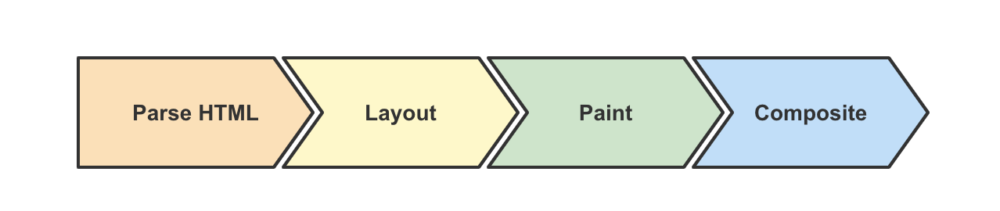
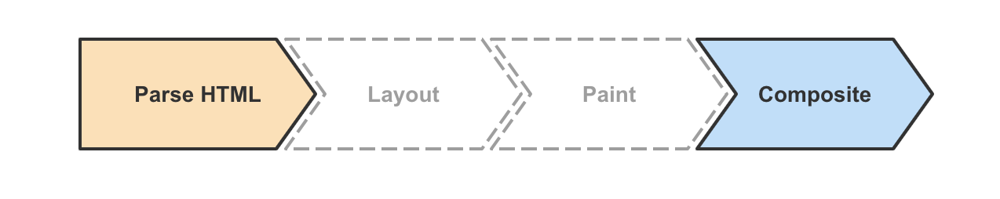

# 浏览器的重排重绘

## 相关问题

- 如何提升页面渲染性能
- 如何减少页面重排重绘
- 哪些行为会引起重排/重绘

## 回答关键点

`渲染性能` `Layout` `Paint`

浏览器渲染大致分为四个阶段，其中在解析 HTML 后，会依次进入 Layout 和 Paint 阶段。**样式或节点的更改，以及对布局信息的访问等**，都有可能导致重排和重绘。而重排和重绘的过程在**主线程**中进行，这意味着不合理的重排重绘会导致**渲染卡顿，用户交互滞后**等性能问题。

## 知识点深入

### 1. 什么是重排重绘

1. Parse HTML：相关引擎分别解析文档和样式表以及脚本，生成 DOM 和 CSSOM ，最终合成为 Render 树。
2. Layout：浏览器通过 Render 树中的信息，以递归的形式计算出每个节点的尺寸大小和在页面中的具体位置。
3. Paint：浏览器将 Render 树中的节点转换成在屏幕上绘制实际像素的指令，这个过程发生在多个图层上。
4. Composite：浏览器将所有层按照一定顺序合并为一个图层并绘制在屏幕上。

图中所示步骤为浏览器渲染的关键路径。浏览器从获取文档、样式、脚本等内容，到最终渲染结果到屏幕上，通常需要经过如图所示的步骤。而 DOM 或 CSSOM 被修改，会导致浏览器重复执行图中的步骤。重排和重绘，本质上指的就是触发 Layout 和 Paint 的过程，且重排必定导致重绘。

#### 引起重排/重绘的常见操作

1. 外观有变化时，会导致**重绘**。相关的样式属性如 `color` `opacity` 等。
2. 布局结构或节点内容变化时，会导致**重排**。相关的样式属性如 `height` `float` `position` 等。
    - 盒子尺寸和类型。
    - 定位方案（正常流、浮动和绝对定位）。
    - 文档树中元素之间的关系。
    - 外部信息（如视口大小等）。
3. 获取布局信息时，会导致**重排**。相关的方法属性如 `offsetTop` `getComputedStyle` 等。

### 2. 如何减少重排重绘

#### 意义

大多数显示器的刷新率是 60FPS（frames per second）。理想情况下，浏览器需要在 1/60 秒内完成渲染阶段并交付一帧。这样用户就会看到一个交互流畅的页面。

在交互阶段，页面更新（一般是通过执行 JavaScript 来触发）通常会触发重排和重绘。为了提升浏览器渲染效率，应当尽可能减少重绘重排（跳过 Layout/Paint 步骤），从而降低浏览器渲染耗费的时间，将内容尽快渲染到屏幕上。

#### 解决方案

1. 对 DOM 进行批量写入和读取（通过虚拟 DOM 或者 DocumentFragment 实现）。
2. 避免对样式频繁操作，了解常用样式属性触发 Layout / Paint / Composite 的[机制](https://csstriggers.com/)，合理使用样式。
3. 合理利用特殊样式属性（如 transform: translateZ(0) 或者 will-change），将渲染层提升为合成层，开启 GPU 加速，提高页面性能。
4. 使用变量对布局信息（如 clientTop）进行缓存，避免因频繁读取布局信息而触发重排和重绘。

另外，可以借助 DevTools Performance 面板来查看产生重排重绘任务占用主线程的情况和调用代码。

## 参考资料

1. [渲染树构建、布局及绘制](https://developers.google.com/web/fundamentals/performance/critical-rendering-path/render-tree-construction?hl=zh-cn)
2. [避免大型、复杂的布局和布局抖动](https://developers.google.com/web/fundamentals/performance/rendering/avoid-large-complex-layouts-and-layout-thrashing)
3. [CSS 属性触发布局、绘制及合成的数据](https://csstriggers.com/)
4. [What forces layout / reflow](https://gist.github.com/paulirish/5d52fb081b3570c81e3a)
