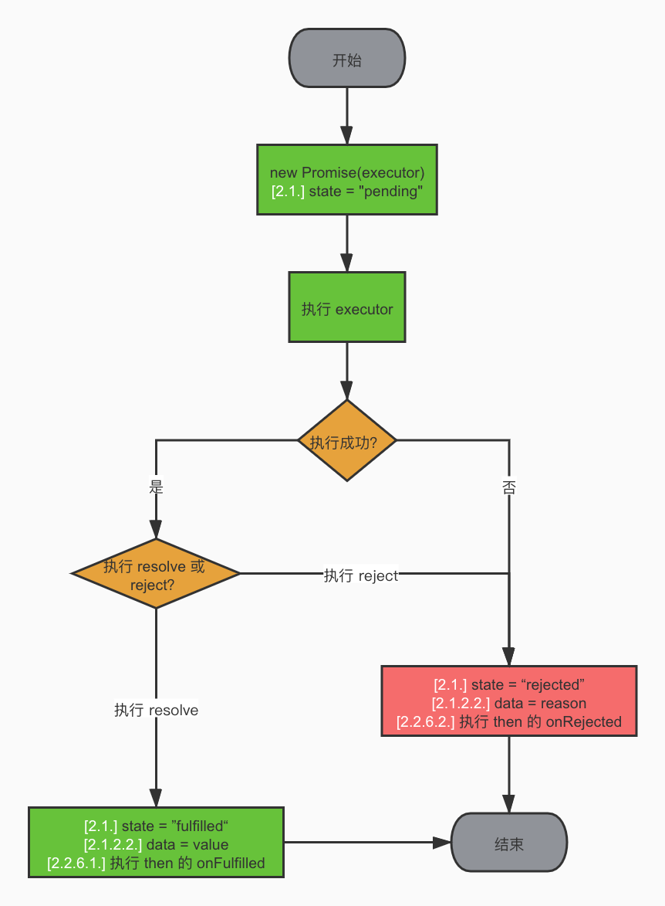
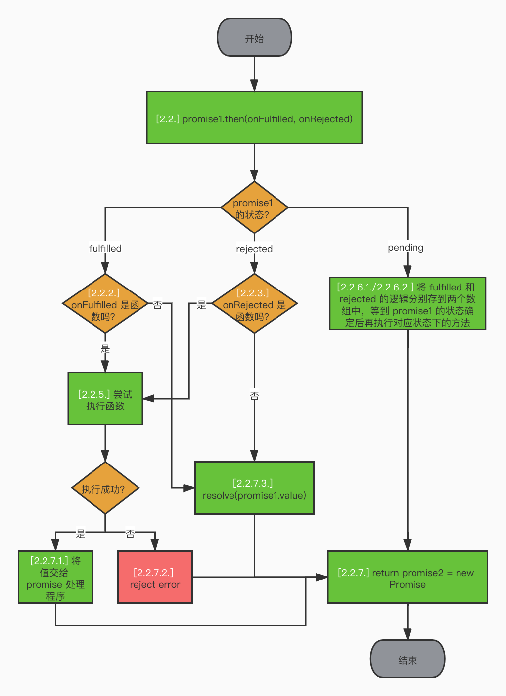
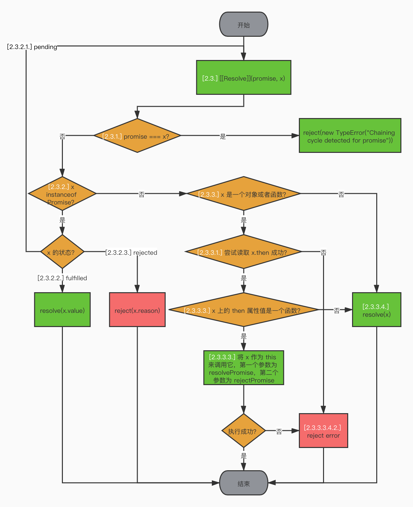
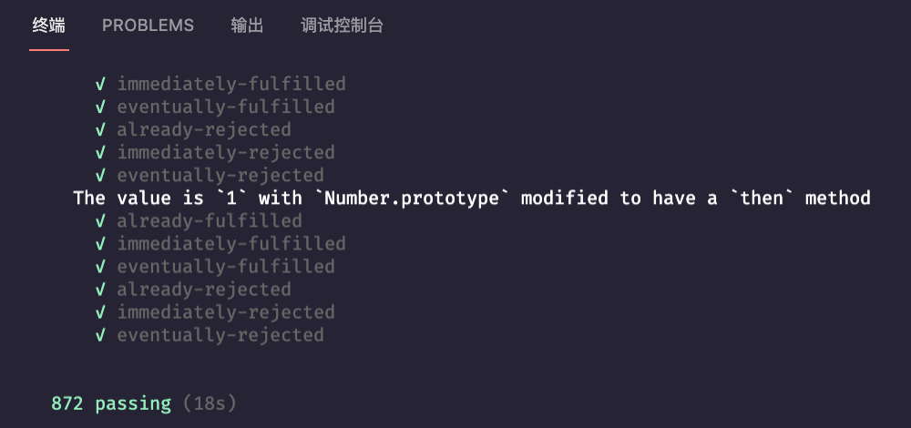

# 实现一个符合 Promises/A+ 规范的 Promise


这是一道有着成熟的业界规范的 coding 题，完成这道题的前置知识就是要了解什么是 [Promises/A+](https://promisesaplus.com)。


这道题的难点就在于它是有规范的，任何一个不满足所有规范条件的解答都是错误的。同时，成熟的规范也配套了成熟的[测试用例](https://github.com/promises-aplus/promises-tests)，官方提供了 872 个测试用例针对规范中的所有条件一一进行检测，哪怕只有一条失败，那也是错误的解答。


而这道题的答题关键也恰恰是因为它是有规范的，只要我们对于规范了然于胸，那么编写代码自然也是水到渠成。因为官方规范提供了一个符合 Promises/A+ 规范的 Promise 应该具有的全部条件，并且在 [Requirements](https://promisesaplus.com/#requirements) 一节中结构清晰、逻辑充分的表述了出来，我们只需将规范中的文字转变为代码，就能够实现一个 Promises/A+ 规范的 Promise。


## 编写代码


因为规范条例较多，我们拆解成三块来理解记忆，分别是：基础框架、then 方法和 Promise 处理程序。


每一块由两部分构成：

- 流程图：展示了代码逻辑的关键步骤，也是优先需要理解记忆的点。
- 实现代码：展示了代码逻辑的具体细节，是对关键步骤的完善补全。


其中，**涉及到规范条例的点会注明规范序号**。


再次强调，**本题的答题关键是熟悉规范**！磨刀不误砍柴工，务必先熟悉！熟悉！熟悉！


### 1. 基础框架


#### 1.1 流程图





#### 1.2 实现代码


```js
function Promise(executor) {
  // 2.1. Promise 的状态
  // Promise 必须处于以下三种状态之一：pending，fulfilled 或者 rejected。
  this.state = "pending";
  // 2.2.6.1. 如果 promise 处于 fulfilled 状态，所有相应的 onFulfilled 回调必须按照它们对应的 then 的原始调用顺序来执行。
  this.onFulfilledCallback = [];
  // 2.2.6.2. 如果 promise 处于 rejected 状态，所有相应的 onRejected 回调必须按照它们对应的 then 的原始调用顺序来执行。
  this.onRejectedCallback = [];

  const self = this;

  function resolve(value) {
    setTimeout(function () {
      // 2.1.1. 当 Promise 处于 pending 状态时：
      // 2.1.1.1. 可以转换到 fulfilled 或 rejected 状态。
      // 2.1.2. 当 Promise 处于 fulfilled 状态时：
      // 2.1.2.1. 不得过渡到任何其他状态。
      // 2.1.2.2. 必须有一个不能改变的值。
      if (self.state === "pending") {
        self.state = "fulfilled";
        self.data = value;
        // 2.2.6.1. 如果 promise 处于 fulfilled 状态，所有相应的 onFulfilled 回调必须按照它们对应的 then 的原始调用顺序来执行。
        for (let i = 0; i < self.onFulfilledCallback.length; i++) {
          self.onFulfilledCallback[i](value);
        }
      }
    });
  }

  function reject(reason) {
    setTimeout(function () {
      // 2.1.1. 当 Promise 处于 pending 状态时：
      // 2.1.1.1. 可以转换到 fulfilled 或 rejected 状态。
      // 2.1.3. 当 Promise 处于 rejected 状态时：
      // 2.1.2.1. 不得过渡到任何其他状态。
      // 2.1.2.2. 必须有一个不能改变的值。
      if (self.state === "pending") {
        self.state = "rejected";
        self.data = reason;
        // 2.2.6.2. 如果 promise 处于 rejected 状态，所有相应的 onRejected 回调必须按照它们对应的 then 的原始调用顺序来执行。
        for (let i = 0; i < self.onRejectedCallback.length; i++) {
          self.onRejectedCallback[i](reason);
        }
      }
    });
  }

  // 补充说明：用户传入的函数可能也会执行异常，所以这里用 try...catch 包裹
  try {
    executor(resolve, reject);
  } catch (reason) {
    reject(reason);
  }
}
```


### 2. then 方法


#### 2.1 流程图





#### 2.2 实现代码


```js
// 2.2. then 方法
// 一个 promise 必须提供一个 then 方法来访问其当前值或最终值或 rejected 的原因。
// 一个 promise 的 then 方法接受两个参数：
// promise.then(onFulfilled, onRejected)
Promise.prototype.then = function (onFulfilled, onRejected) {
  const self = this;

  let promise2;
  // 2.2.7. then 必须返回一个 promise
  return (promise2 = new Promise(function (resolve, reject) {
    // 2.2.2. 如果 onFulfilled 是一个函数:
    // 2.2.2.1. 它必须在 promise 的状态变为 fulfilled 后被调用，并将 promise 的值作为它的第一个参数。
    // 2.2.2.2. 它一定不能在 promise 的状态变为 fulfilled 前被调用。
    // 2.2.2.3. 它最多只能被调用一次。
    if (self.state === "fulfilled") {
      // 2.2.4. onFulfilled 或 onRejected 在执行上下文堆栈仅包含平台代码之前不得调用。
      // 3.1. 这可以通过“宏任务”机制（例如 setTimeout 或 setImmediate）或“微任务”机制（例如 MutationObserver 或 process.nextTick）来实现。
      setTimeout(function () {
        // 2.2.1. onFulfilled 和 onRejected 都是可选参数：
        // 2.2.1.1. 如果 onFulfilled 不是一个函数，它必须被忽略。
        if (typeof onFulfilled === "function") {
          try {
            // 2.2.2.1. 它必须在 promise 的状态变为 fulfilled 后被调用，并将 promise 的值作为它的第一个参数。
            // 2.2.5. onFulfilled 和 onRejected 必须作为函数调用。
            const x = onFulfilled(self.data);
            // 2.2.7.1. 如果 onFulfilled 或 onRejected 返回了一个值 x，则运行 Promise 处理程序 [[Resolve]](promise2, x)。
            promiseResolutionProcedure(promise2, x, resolve, reject);
          } catch (e) {
            // 2.2.7.2. 如果 onFulfilled 或 onRejected 抛出了一个异常，promise2 必须用 e 作为 reason 来变为 rejected 状态。
            reject(e);
          }
        } else {
          // 2.2.7.3. 如果 onFulfilled 不是一个函数且 promise1 为 fulfilled 状态，promise2 必须用和 promise1 一样的值来变为 fulfilled 状态。
          resolve(self.data);
        }
      });
    }
    // 2.2.3. 如果 onRejected 是一个函数，
    // 2.2.3.1. 它必须在 promise 的状态变为 rejected 后被调用，并将 promise 的 reason 作为它的第一个参数。
    // 2.2.3.2. 它一定不能在 promise 的状态变为 rejected 前被调用。
    // 2.2.3.3. 它最多只能被调用一次。
    else if (self.state === "rejected") {
      // 2.2.4. onFulfilled 或 onRejected 在执行上下文堆栈仅包含平台代码之前不得调用。
      // 3.1. 这可以通过“宏任务”机制（例如 setTimeout 或 setImmediate）或“微任务”机制（例如 MutationObserver 或 process.nextTick）来实现。
      setTimeout(function () {
        // 2.2.1. onFulfilled 和 onRejected 都是可选参数：
        // 2.2.1.2. 如果 onRejected 不是一个函数，它必须被忽略。
        if (typeof onRejected === "function") {
          try {
            // 2.2.3.1. 它必须在 promise 的状态变为 rejected 后被调用，并将 promise 的 reason 作为它的第一个参数。
            // 2.2.5. onFulfilled 和 onRejected 必须作为函数调用。
            const x = onRejected(self.data);
            // 2.2.7.1. 如果 onFulfilled 或 onRejected 返回了一个值 x，则运行 Promise 处理程序 [[Resolve]](promise2, x)。
            promiseResolutionProcedure(promise2, x, resolve, reject);
          } catch (e) {
            // 2.2.7.2. 如果 onFulfilled 或 onRejected 抛出了一个异常，promise2 必须用 e 作为 reason 来变为 rejected 状态。
            reject(e);
          }
        }
        // 2.2.7.4. 如果 onRejected 不是一个函数且 promise1 为 rejected 状态，promise2 必须用和 promise1 一样的 reason 来变为 rejected 状态。
        else {
          reject(self.data);
        }
      });
    } else if (self.state === "pending") {
      // 2.2.6. then 可能会被同一个 promise 多次调用。

      // 2.2.6.1. 如果 promise 处于 fulfilled 状态，所有相应的 onFulfilled 回调必须按照它们对应的 then 的原始调用顺序来执行。
      self.onFulfilledCallback.push(function (promise1Value) {
        if (typeof onFulfilled === "function") {
          try {
            // 2.2.2.1. 它必须在 promise 的状态变为 fulfilled 后被调用，并将 promise 的值作为它的第一个参数。
            // 2.2.5. onFulfilled 和 onRejected 必须作为函数调用。
            const x = onFulfilled(self.data);
            // 2.2.7.1. 如果 onFulfilled 或 onRejected 返回了一个值 x，则运行 Promise 处理程序 [[Resolve]](promise2, x)。
            promiseResolutionProcedure(promise2, x, resolve, reject);
          } catch (e) {
            // 2.2.7.2. 如果 onFulfilled 或 onRejected 抛出了一个异常，promise2 必须用 e 作为 reason 来变为 rejected 状态。
            reject(e);
          }
        }
        // 2.2.7.3. 如果 onFulfilled 不是一个函数且 promise1 为 fulfilled 状态，promise2 必须用和 promise1 一样的值来变为 fulfilled 状态。
        else {
          resolve(promise1Value);
        }
      });
      // 2.2.6.2. 如果 promise 处于 rejected 状态，所有相应的 onRejected 回调必须按照它们对应的 then 的原始调用顺序来执行。
      self.onRejectedCallback.push(function (promise1Reason) {
        if (typeof onRejected === "function") {
          try {
            // 2.2.3.1. 它必须在 promise 的状态变为 rejected 后被调用，并将 promise 的 reason 作为它的第一个参数。
            // 2.2.5. onFulfilled 和 onRejected 必须作为函数调用。
            const x = onRejected(self.data);
            // 2.2.7.1. 如果 onFulfilled 或 onRejected 返回了一个值 x，则运行 Promise 处理程序 [[Resolve]](promise2, x)。
            promiseResolutionProcedure(promise2, x, resolve, reject);
          } catch (e) {
            // 2.2.7.2. 如果 onFulfilled 或 onRejected 抛出了一个异常，promise2 必须用 e 作为 reason 来变为 rejected 状态。
            reject(e);
          }
        }
        // 2.2.7.4. 如果 onRejected 不是一个函数且 promise1 为 rejected 状态，promise2 必须用和 promise1 一样的 reason 来变为 rejected 状态。
        else {
          reject(promise1Reason);
        }
      });
    }
  }));
};
```


### 3. Promise 处理程序


#### 3.1 流程图





#### 3.2 实现代码


```js
// 2.3. Promise 处理程序
// Promise 处理程序是一个将 promise 和 value 作为输入的抽象操作，我们将其表示为 [[Resolve]](promise, x)。
// 补充说明：这里我们将 resolve 和 reject 也传入进来，因为后续要根据不同的逻辑对 promise 执行 fulfill 或 reject 操作。
function promiseResolutionProcedure(promise2, x, resolve, reject) {
  // 2.3.1. 如果 promise 和 x 引用的是同一个对象，promise 将以一个 TypeError 作为 reason 来进行 reject。
  if (promise2 === x) {
    return reject(new TypeError("Chaining cycle detected for promise"));
  }

  // 2.3.2. 如果 x 是一个 promise，根据它的状态：
  if (x instanceof Promise) {
    // 2.3.2.1. 如果 x 的状态为 pending，promise 必须保持 pending 状态直到 x 的状态变为 fulfilled 或 rejected。
    if (x.state === "pending") {
      x.then(function (value) {
        promiseResolutionProcedure(promise2, value, resolve, reject);
      }, reject);
    }
    // 2.3.2.2. 如果 x 的状态为 fulfilled，那么 promise 也用同样的值来执行 fulfill 操作。
    else if (x.state === "fulfilled") {
      resolve(x.data);
    }
    // 2.3.2.3. 如果 x 的状态为 rejected，那么 promise 也用同样的 reason 来执行 reject 操作。
    else if (x.state === "rejected") {
      reject(x.data);
    }
    return;
  }

  // 2.3.3. 除此之外，如果 x 是一个对象或者函数，
  if (x && (typeof x === "object" || typeof x === "function")) {
    // 2.3.3.3.3. 如果 resolvePromise 和 rejectPromise 都被调用，或者多次调用同样的参数，则第一次调用优先，任何之后的调用都将被忽略。
    let isCalled = false;

    try {
      // 2.3.3.1. 声明一个 then 变量来保存 then
      let then = x.then;
      // 2.3.3.3. 如果 then 是一个函数，将 x 作为 this 来调用它，第一个参数为 resolvePromise，第二个参数为 rejectPromise，其中：
      if (typeof then === "function") {
        then.call(
          x,
          // 2.3.3.3.1. 假设 resolvePromise 使用一个名为 y 的值来调用，运行 promise 处理程序 [[Resolve]](promise, y)。
          function resolvePromise(y) {
            // 2.3.3.3.3. 如果 resolvePromise 和 rejectPromise 都被调用，或者多次调用同样的参数，则第一次调用优先，任何之后的调用都将被忽略。
            if (isCalled) return;
            isCalled = true;
            return promiseResolutionProcedure(promise2, y, resolve, reject);
          },
          // 2.3.3.3.2. 假设 rejectPromise 使用一个名为 r 的 reason 来调用，则用 r 作为 reason 对 promise 执行 reject 操作。
          function rejectPromise(r) {
            // 2.3.3.3.3. 如果 resolvePromise 和 rejectPromise 都被调用，或者多次调用同样的参数，则第一次调用优先，任何之后的调用都将被忽略。
            if (isCalled) return;
            isCalled = true;
            return reject(r);
          }
        );
      }
      // 2.3.3.4. 如果 then 不是一个函数，使用 x 作为值对 promise 执行 fulfill 操作。
      else {
        resolve(x);
      }
    } catch (e) {
      // 2.3.3.2. 如果检索 x.then 的结果抛出异常 e，使用 e 作为 reason 对 promise 执行 reject 操作。
      // 2.3.3.3.4. 如果调用 then 时抛出一个异常 e，
      // 2.3.3.3.4.1. 如果 resolvePromise 或 rejectPromise 已经被调用过了，则忽略异常。
      if (isCalled) return;
      isCalled = true;
      // 2.3.3.3.4.2. 否则，使用 e 作为 reason 对 promise 执行 reject 操作。
      reject(e);
    }
  }
  // 2.3.4. 如果 x 不是一个对象或者函数，使用 x 作为值对 promise 执行 fulfill 操作。
  else {
    resolve(x);
  }
}
```


### 4. 完整代码


```js
function Promise(executor) {
  this.state = "pending";
  this.onFulfilledCallback = [];
  this.onRejectedCallback = [];

  const self = this;

  function resolve(value) {
    setTimeout(function () {
      if (self.state === "pending") {
        self.state = "fulfilled";
        self.data = value;
        for (let i = 0; i < self.onFulfilledCallback.length; i++) {
          self.onFulfilledCallback[i](value);
        }
      }
    });
  }

  function reject(reason) {
    setTimeout(function () {
      if (self.state === "pending") {
        self.state = "rejected";
        self.data = reason;
        for (let i = 0; i < self.onRejectedCallback.length; i++) {
          self.onRejectedCallback[i](reason);
        }
      }
    });
  }

  try {
    executor(resolve, reject);
  } catch (reason) {
    reject(reason);
  }
}

Promise.prototype.then = function (onFulfilled, onRejected) {
  const self = this;

  let promise2;

  return (promise2 = new Promise(function (resolve, reject) {
    if (self.state === "fulfilled") {
      setTimeout(function () {
        if (typeof onFulfilled === "function") {
          try {
            const x = onFulfilled(self.data);

            promiseResolutionProcedure(promise2, x, resolve, reject);
          } catch (e) {
            reject(e);
          }
        } else {
          resolve(self.data);
        }
      });
    } else if (self.state === "rejected") {
      setTimeout(function () {
        if (typeof onRejected === "function") {
          try {
            const x = onRejected(self.data);

            promiseResolutionProcedure(promise2, x, resolve, reject);
          } catch (e) {
            reject(e);
          }
        } else {
          reject(self.data);
        }
      });
    } else if (self.state === "pending") {
      self.onFulfilledCallback.push(function (promise1Value) {
        if (typeof onFulfilled === "function") {
          try {
            const x = onFulfilled(self.data);

            promiseResolutionProcedure(promise2, x, resolve, reject);
          } catch (e) {
            reject(e);
          }
        } else {
          resolve(promise1Value);
        }
      });

      self.onRejectedCallback.push(function (promise1Reason) {
        if (typeof onRejected === "function") {
          try {
            const x = onRejected(self.data);

            promiseResolutionProcedure(promise2, x, resolve, reject);
          } catch (e) {
            reject(e);
          }
        } else {
          reject(promise1Reason);
        }
      });
    }
  }));
};

function promiseResolutionProcedure(promise2, x, resolve, reject) {
  if (promise2 === x) {
    return reject(new TypeError("Chaining cycle detected for promise"));
  }

  if (x instanceof Promise) {
    if (x.state === "pending") {
      x.then(function (value) {
        promiseResolutionProcedure(promise2, value, resolve, reject);
      }, reject);
    } else if (x.state === "fulfilled") {
      resolve(x.data);
    } else if (x.state === "rejected") {
      reject(x.data);
    }
    return;
  }

  if (x && (typeof x === "object" || typeof x === "function")) {
    let isCalled = false;

    try {
      let then = x.then;

      if (typeof then === "function") {
        then.call(
          x,
          function resolvePromise(y) {
            if (isCalled) return;
            isCalled = true;
            return promiseResolutionProcedure(promise2, y, resolve, reject);
          },
          function rejectPromise(r) {
            if (isCalled) return;
            isCalled = true;
            return reject(r);
          }
        );
      } else {
        resolve(x);
      }
    } catch (e) {
      if (isCalled) return;
      isCalled = true;
      reject(e);
    }
  } else {
    resolve(x);
  }
}

module.exports = Promise;
```


## 测试代码


开头我们就说过，Promises/A+ 规范配套了成熟的[测试用例](https://github.com/promises-aplus/promises-tests)，我们必须全部通过才算代码编写正确。下面我们就用 872 个官方测试用例来测试一下我们的完整代码是否符合 Promises/A+ 规范。


### 1. 暴露一个简单的适配器接口


```js
// test.js

// 导入我们写好的 promise
const Promise = require("./promise.js");

// 根据官方文档暴露一个 deferred 方法，返回一个包含 promise、resolve、reject 的对象
Promise.deferred = function () {
  const obj = {};

  obj.promise = new Promise(function (resolve, reject) {
    obj.resolve = resolve;
    obj.reject = reject;
  });

  return obj;
};

module.exports = Promise;
```


### 2. 运行命令


```bash
$ npx promises-aplus-tests test.js
```


### 3. 测试结果





完美通过！


## 参考资料

1. [Promises/A+](https://promisesaplus.com/)
2. [Promises/A+ Compliance Test Suite](https://github.com/promises-aplus/promises-tests)
