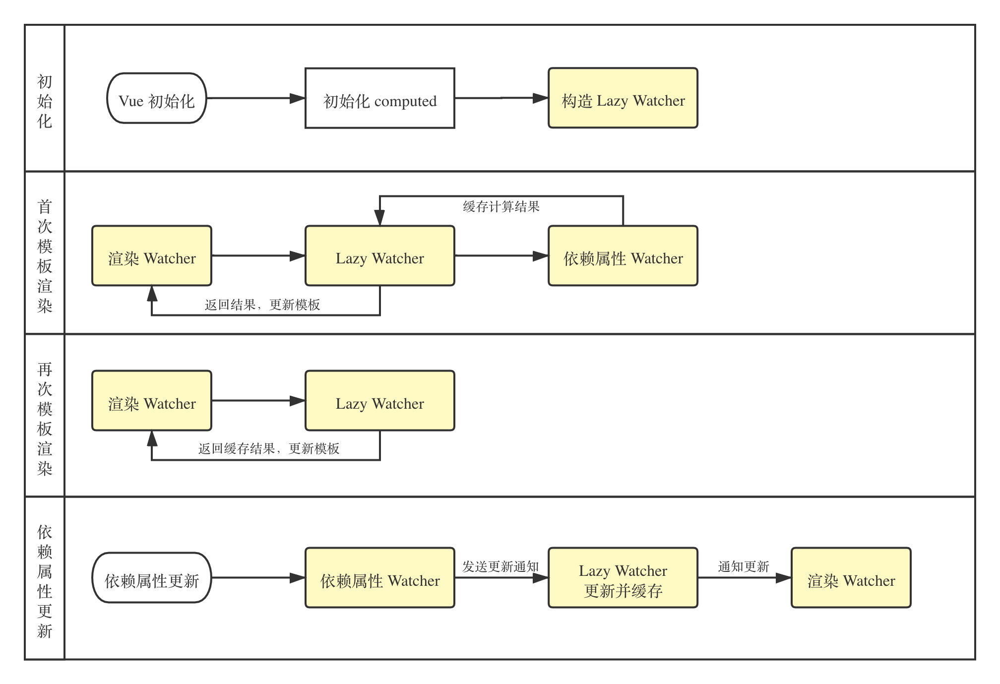

# Vue 的 computed 和 watch 的区别

## 相关问题

- computed 和 watch 的实现原理
- computed 和 watch 的适用场景

## 回答关键点

`响应变化` `属性` `侦听`

computed 是模板表达式的声明式描述，会**创建新的响应式数据**。而 watch 是响应式数据的**自定义侦听器**，用于**响应数据的变化**。除此之外，computed 还具有**可缓存，可依赖多个属性，getter 函数无副作用**等特点。watch 则更适用于**异步或开销大的操作**。

## 知识点深入

### 1. 实现原理

在了解 Vue 数据双向绑定的基础上，computed 等同于为属性设置 **getter 函数**（也可设置 [setter](https://cn.vuejs.org/v2/guide/computed.html#%E8%AE%A1%E7%AE%97%E5%B1%9E%E6%80%A7%E7%9A%84-setter)），而 watch 等同于为属性的 **setter 设置回调函数、监听深度 deep 及响应速度 immediate**。下面简单讲解下两者的实现原理，具体细节可以参考[源码](https://github.com/vuejs/vue)。

#### 1.1 computed 原理

主要分为四个阶段

1. **初始化**：为 computed 属性创建 lazy watcher（此处 watcher 指双向绑定中的监听器，下同）。
2. **首次模板渲染**：渲染 watcher 检测到 computed 属性时，会调用 computed 属性的 getter 方法，而 computed 属性的 getter 方法会调用依赖属性的 getter，从而形成链式调用，同时保存引用关系用于更新。取得计算结果后 lazy watcher 会将结果缓存，并返回给渲染 watcher 进行模板渲染。
3. **多次模板渲染**：直接取 lazy watcher 中的缓存值给到渲染 watcher 进行渲染。
4. **依赖属性更新**：根据首次模板渲染阶段构建的依赖关系向上通知 lazy watcher 进行重新计算，缓存计算结果并通知渲染 watcher 重新渲染更新页面。

#### 1.2 watch 原理

watch 本质上是为每个监听属性 setter 创建了一个 watcher，当被监听的属性更新时，调用传入的回调函数。常见的配置选项有 deep 和 immediate，对应原理如下：

1. **deep**：深度监听对象，为对象的每一个属性创建一个 watcher，从而确保对象的每一个属性更新时都会触发传入的回调函数。主要原因在于对象属于引用类型，单个属性的更新并不会触发对象 setter，因此引入 deep 能够很好地解决监听对象的问题。同时也会引入判断机制，确保在多个属性更新时回调函数仅触发一次，避免性能浪费。
2. **immediate**：在初始化时直接调用回调函数，可以通过在 created 阶段手动调用回调函数实现相同的效果。

### 2. 适用场景

- computed：需要处理复杂逻辑的模板表达式。
- watch：需要执行异步或开销较大的操作。

从表现上看，computed 会创建**新的属性**，而 watch 可以通过**将属性设置在 data 中，再监听依赖属性变化，调用 handler 方法更新属性**的方式达到同样的效果。因此不难得出 computed 的使用场景可以被 watch 覆盖这一结论。但在具体的使用上还是优先考虑 computed，因为相同场景下 watch 所需的代码量和性能开销一般来说会比 computed 大，具体可以参照 [computed vs watched](https://cn.vuejs.org/v2/guide/computed.html#%E8%AE%A1%E7%AE%97%E5%B1%9E%E6%80%A7-vs-%E4%BE%A6%E5%90%AC%E5%B1%9E%E6%80%A7)。在 computed 无法满足需求的情况下再考虑使用 watch，也可以有效避免 watch 滥用，提升性能。

### 3. Vue3 与 Vue2 区别

**Vue3 中 computed 和 watch 的原理以及在 Options API 中的使用方式和 Vue2 保持一致。但在 Vue3 的新特性组合式（Composition）API 中，使用方式和功能相比 Vue2 有了明显差别**。使用方式由原来在组件中声明改为直接从 Vue 中导入使用，各自的调用方式和参数也发生了改变，功能更加多样，同时 Vue3 还引入了 watchEffect 作为 watch 的补充，以求用更简洁的代码来覆盖更广的使用场景。具体使用参考[官方文档](https://v3.cn.vuejs.org/guide/reactivity-computed-watchers.html)。

## 参考资料

1. [Vuejs computed](https://cn.vuejs.org/v2/guide/computed.html)
2. [Vuejs 源码](https://github.com/vuejs/vue)
3. [Vue3 组合式 api](https://v3.cn.vuejs.org/guide/composition-api-introduction.html)
