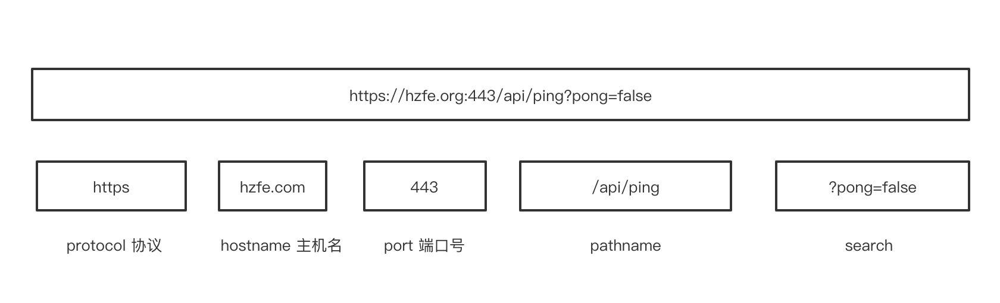
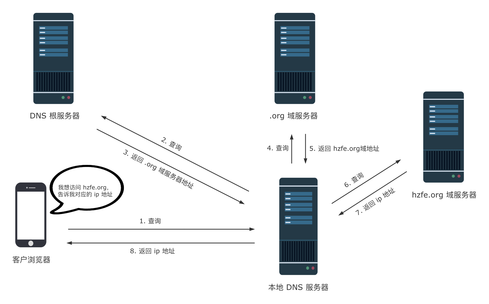
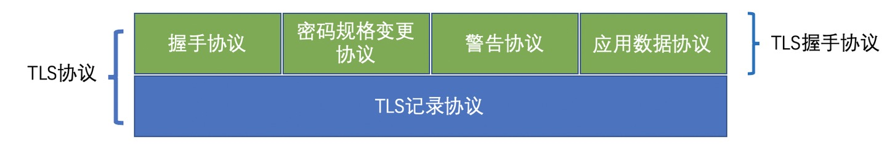
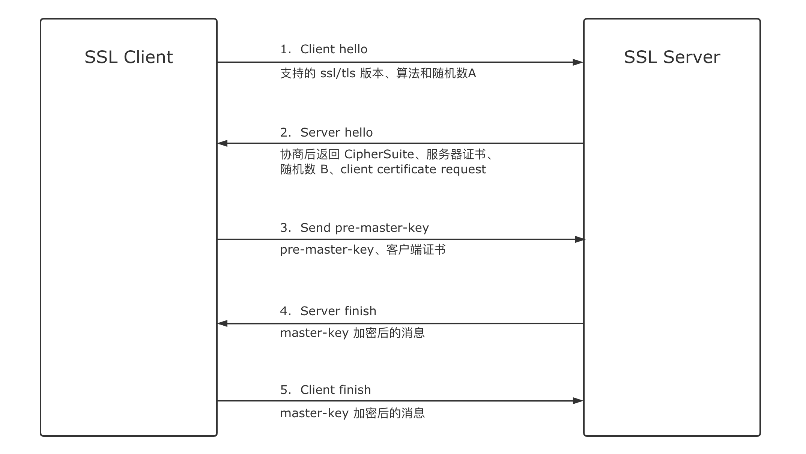
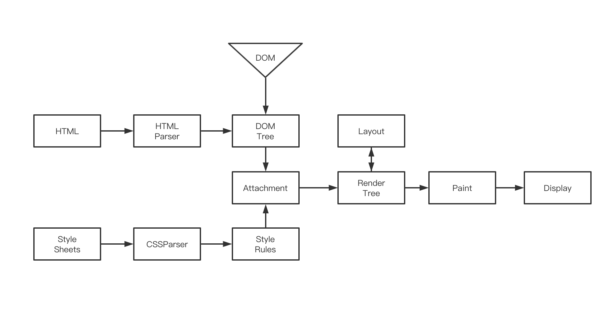
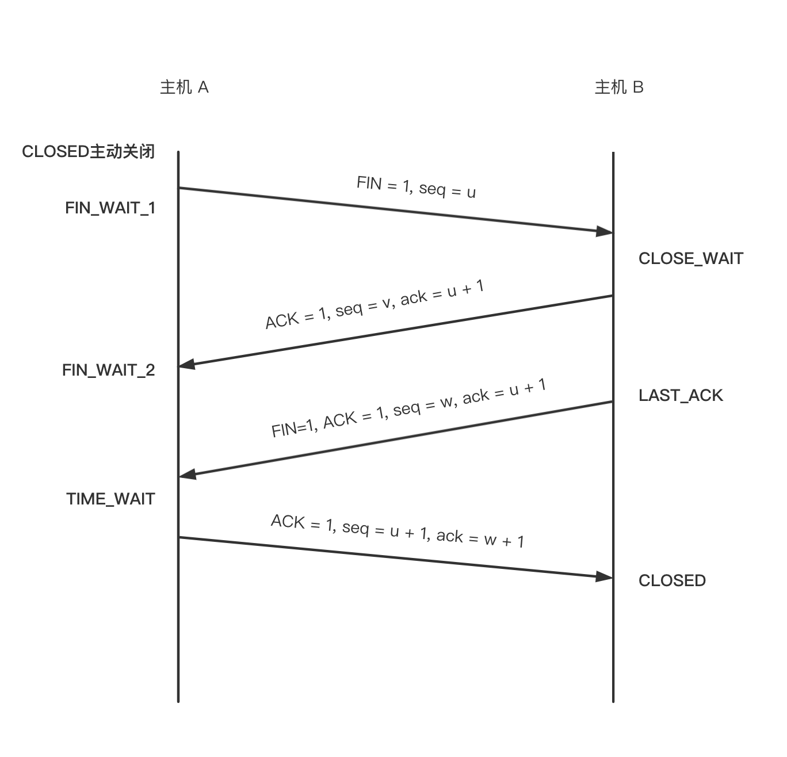

# 浏览器从输入网址到页面展示的过程


## 回答关键点


`URL` `DNS` `TCP` `渲染`


浏览器从输入网址到渲染页面主要分为以下几个过程

- URL 输入
- DNS 解析
- 建立 TCP 连接
- 发送 HTTP / HTTPS 请求（建立 TLS 连接）
- 服务器响应请求
- 浏览器解析渲染页面
- HTTP 请求结束，断开 TCP 连接


## 知识点深入


### 1. URL 输入





URL（统一资源定位符，Uniform Resource Locator）用于定位互联网上资源，俗称网址。


我们在地址栏输入 HZFE 官方网址 hzfe.org 后敲下回车，浏览器会对输入的信息进行以下判断：

1. 检查输入的内容是否是一个合法的 URL 链接。
2. 是，则判断输入的 URL 是否完整。如果不完整，浏览器可能会对域进行猜测，补全前缀或者后缀。
3. 否，将输入内容作为搜索条件，使用用户设置的默认搜索引擎来进行搜索。


大部分浏览器会从历史记录、书签等地方开始查找我们输入的网址，并给出智能提示。


### 2. DNS（Domain Name System）解析


因为浏览器不能直接通过域名找到对应的服务器 IP 地址，所以需要进行 DNS 解析，查找到对应的 IP 地址进行访问。


DNS 解析流程如下：




1. 在浏览器中输入 hzfe.org 域名，操作系统检查浏览器缓存和本地的 hosts 文件中，是否有这个网址记录，有则从记录里面找到对应的 IP 地址，完成域名解析。
2. 查找本地 DNS 解析器缓存中，是否有这个网址记录，有则从记录里面找到对应的 IP 地址，完成域名解析。
3. 使用 TCP/IP 参数中设置的 DNS 服务器进行查询。如果要查询的域名包含在本地配置区域资源中，则返回解析结果，完成域名解析。
4. 检查本地 DNS 服务器是否缓存该网址记录，有则返回解析结果，完成域名解析。
5. 本地 DNS 服务器发送查询报文至根 DNS 服务器，根 DNS 服务器收到请求后，用顶级域 DNS 服务器地址进行响应。
6. 本地 DNS 服务器发送查询报文至顶级域 DNS 服务器。顶级域 DNS 服务器收到请求后，用权威 DNS 服务器地址进行响应。
7. 本地 DNS 服务器发送查询报文至权威 DNS 服务器，权威 DNS 服务器收到请求后，用 hzfe.org 的 IP 地址进行响应，完成域名解析。


查询通常遵循以上流程，从请求主机到本地 DNS 服务器的查询是递归查询，DNS 服务器获取到所需映射的查询过程是迭代查询。


### 3. 建立 TCP 连接


> 世界上几乎所有的 HTTP 通信都是由 TCP/IP 承载的，TCP/IP 是全球计算机及网络设备都在使用的一种常用的分组交换网络分层。 HTTP 的连接实际上就是 TCP 连接以及其使用规则。 –《HTTP 权威指南》


当浏览器获取到服务器的 IP 地址后，浏览器会用一个随机的端口（1024 < 端口 < 65535）向服务器 80 端口发起 TCP 连接请求（注：HTTP 默认约定 80 端口，HTTPS 为 443 端口）。这个连接请求到达服务端后，通过 TCP 三次握手，建立 TCP 的连接。


#### 3.1 分层模型


```text
    ----------------------------------
  7|   应用层   |           |   HTTP  |

  6|   表示层   |   应用层   |

  5|   会话层   |           |         |
    ---------------------------------
  4|   传输层   |   传输层   | TCP TLS |
    ---------------------------------
  3|   网络层   |   网络层   |   IP    |
    ---------------------------------
  2|  数据链路层
               |   链路层
  1|   物理层
    --------------------------------
       [OSI]   |   [TCP/IP]
```


#### 3.2 TCP 三次握手


```text
# SYN 是建立连接时的握手信号，TCP 中发送第一个 SYN 包的为客户端，接收的为服务端
# TCP 中，当发送端数据到达接收端时，接收端返回一个已收到消息的通知。这个消息叫做确认应答 ACK

  假设有客户端A，服务端B。我们要建立可靠的数据传输。
      SYN(=j)       // SYN: A 请求建立连接
  A ----------> B
                |
     ACK(=j+1)  |   // ACK: B 确认应答 A 的 SYN
     SYN(=k)    |   // SYN: B 发送一个 SYN
  A <-----------
  |
  |  ACK(=k+1)
   -----------> B   // ACK: A 确认应答 B 的包
```

1. 客户端发送 SYN 包（seq = j）到服务器，并进入 SYN_SEND 状态，等待服务器确认。
2. 服务器收到 SYN 包，必须确认客户的 SYN（ACK = k + 1），同时自己也发送一个 SYN 包（seq = k），即 SYN+ACK 包，此时服务器进入 SYN_RECV 状态。
3. 客户端收到服务器的 SYN+ACK 包，向服务器发送确认包 ACK（ACK = k + 1），此包发送完毕，客户端和服务器进入 ESTABLISHED 状态，完成三次握手。


### 4. TLS 协商





建立连接后就可以通过 HTTP 进行数据传输。如果使用 HTTPS，会在 TCP 与 HTTP 之间多添加一层协议做加密及认证的服务。HTTPS 使用 SSL（Secure Socket Layer） 和 TLS（Transport Layer Security） 协议，保障了信息的安全。

- SSL
    - 认证用户和服务器，确保数据发送到正确的客户端和服务器。
    - 加密数据防止数据中途被窃取。
    - 维护数据的完整性，确保数据在传输过程中不被改变。
- TLS
    - 用于在两个通信应用程序之间提供保密性和数据完整性。该协议由两层组成：TLS 记录协议（TLS Record）和 TLS 握手协议（TLS Handshake）。较低的层为 TLS 记录协议，位于某个可靠的传输协议（例如 TCP）上面。


#### 4.1 TLS 握手协议




1. 客户端发出一个 client hello 消息，携带的信息包括：所支持的 SSL/TLS 版本列表；支持的与加密算法；所支持的数据压缩方法；随机数 A。
2. 服务端响应一个 server hello 消息，携带的信息包括：协商采用的 SSL/TLS 版本号；会话 ID；随机数 B；服务端数字证书 serverCA；由于双向认证需求，服务端需要对客户端进行认证，会同时发送一个 client certificate request，表示请求客户端的证书。
3. 客户端校验服务端的数字证书；校验通过之后发送随机数 C，该随机数称为 pre-master-key，使用数字证书中的公钥加密后发出；由于服务端发起了 client certificate request，客户端使用私钥加密一个随机数 clientRandom 随客户端的证书 clientCA 一并发出。
4. 服务端校验客户端的证书，并成功将客户端加密的随机数 clientRandom 解密；根据随机数 A/随机数 B/随机数 C（pre-master-key） 产生动态密钥 master-key，加密一个 finish 消息发至客户端。
5. 客户端根据同样的随机数和算法生成 master-key，加密一个 finish 消息发送至服务端。
6. 服务端和客户端分别解密成功，至此握手完成，之后的数据包均采用 master-key 进行加密传输。


### 5. 服务器响应


当浏览器到 web 服务器的连接建立后，浏览器会发送一个初始的 HTTP GET 请求，请求目标通常是一个 HTML 文件。服务器收到请求后，将发回一个 HTTP 响应报文，内容包括相关响应头和 HTML 正文。


```HTML
<html>
 <head>
  <meta charset="UTF-8"/>
  <title>我的博客</title>
  <link rel="stylesheet" src="styles.css"/>
  <scrIPt src="index.js"></scrIPt>
</head>
<body>
  <h1 class="heading">首页</h1>
  <p>A paragraph with a <a href="https://hzfe.org/">link</a></p>
  <scrIPt src="index.js"></scrIPt>
</body>
</html>
```


#### 5.1 状态码


状态码是由 3 位数组成，第一个数字定义了响应的类别，且有五类可能取值

- 1xx：指示信息——表示请求已接收，继续处理
- 2xx：成功——表示请求已被成功接收、理解、接受
- 3xx：重定向——要完成请求必须进行更进一步的操作
- 4xx：客户端错误——请求有语法错误或请求无法实现
- 5xx：服务器端错误——服务器未能实现合法的请求


#### 5.2 常见的请求头和字段

- Cache-Control：must-revalidate、no-cache、private（是否需要缓存资源）
- Connection：keep-alive（保持连接）
- Content-Encoding：gzip（web 服务器支持的返回内容压缩编码类型）
- Content-Type：text/html；charset=UTF-8（文件类型和字符编码格式）
- Date：Sun， 21 Sep 2021 06:18:21 GMT（服务器消息发出的时间）
- Transfer-Encoding：chunked（服务器发送的资源的方式是分块发送）


#### 5.3 HTTP 响应报文


响应报文由四部分组成（响应行 + 响应头 + 空行 + 响应体）

- 状态行：HTTP 版本 + 空格 + 状态码 + 空格 + 状态码描述 + 回车符（CR） + 换行符（LF）
- 响应头：字段名 + 冒号 + 值 + 回车符 + 换行符
- 空行：回车符 + 换行符
- 响应体：由用户自定义添加，如 post 的 body 等


### 6. 浏览器解析并绘制


不同的浏览器引擎渲染过程都不太一样，这里以 Chrome 浏览器渲染方式为例。




1. 处理 HTML 标记并构建 DOM 树。
2. 处理 CSS 标记并构建 CSSOM 树。
3. 将 DOM 与 CSSOM 合并成一个渲染树。
4. 根据渲染树来布局，以计算每个节点的几何信息。
5. 将各个节点绘制到屏幕上。


### 7. TCP 断开连接


现在的页面为了优化请求的耗时，默认都会开启持久连接（keep-alive），那么一个 TCP 连接确切关闭的时机，是这个 tab 标签页关闭的时候。这个关闭的过程就是**四次挥手**。关闭是一个全双工的过程，发包的顺序是不一定的。一般来说是客户端主动发起的关闭，过程如下图所示：


1. 主动关闭方发送一个 FIN，用来关闭主动方到被动关闭方的数据传送，也就是主动关闭方告诉被动关闭方：我已经不会再给你发数据了（在 FIN 包之前发送出去的数据，如果没有收到对应的 ACK 确认报文，主动关闭方依然会重发这些数据），但此时主动关闭方还可以接受数据。
2. 被动关闭方收到 FIN 包后，发送一个 ACK 给对方，确认序号为收到序号+1（与 SYN 相同，一个 FIN 占用一个序号）。
3. 被动关闭方发送一个 FIN，用来关闭被动关闭方到主动关闭方的数据传送，也就是告诉主动关闭方，我的数据也发送完了，不会再给你发数据了。
4. 主动关闭方收到 FIN 后，发送一个 ACK 给被动关闭方，确认序号为收到序号+1，至此，完成四次挥手。


## 参考资料

1. [How_browsers_work](HTTPS://developer.mozilla.org/en-US/docs/Web/Performance/How_browsers_work)
2. [DOMTokenList](HTTPS://developer.mozilla.org/en-US/docs/Web/API/DOMTokenList)
3. [图解 SSL/TLS 协议](HTTP://www.ruanyifeng.com/blog/2014/09/illustration-ssl.html)
4. [DNS 域名系统](HTTPS://zh.wikIPedia.org/wiki/%E5%9F%9F%E5%90%8D%E7%B3%BB%E7%BB%9F)
