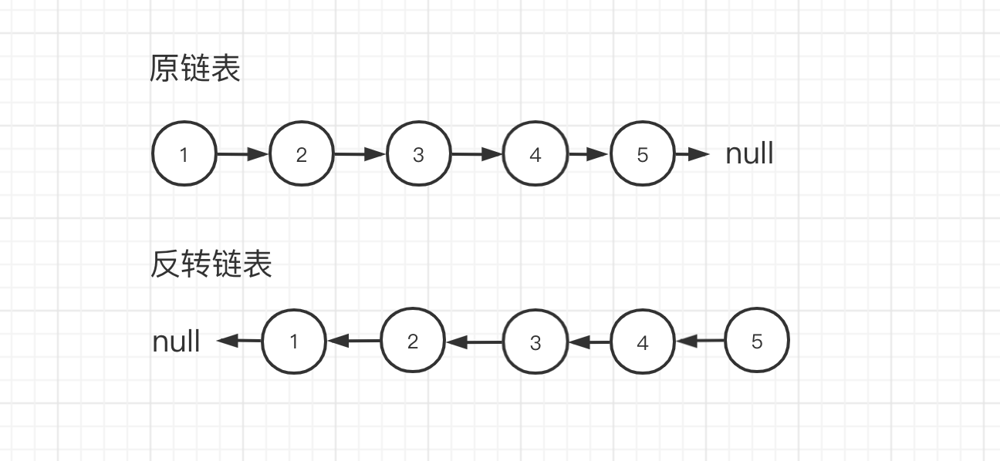

# 反转链表


## 题目描述


定义一个函数，输入一个链表的头节点，反转该链表并输出反转后链表的头节点。





示例：


```text

输入: 1->2->3->4->5->NULL
输出: 5->4->3->2->1->NULL
```


## 解法一：迭代（双指针）


[在线链接](https://codesandbox.io/s/hzfe-suanfa-omcjw?file=/index.html)


本方法是对链表进行遍历，然后在访问各节点时修改 next 的指向，达到反转链表的目的。

1. 初始化 cur 和 pre 两个节点，分别指向 head 和 null。
2. 对链表进行循环，声明 temp 节点用来保存当前节点的下一个节点。
3. 修改当前节点 cur 的 next 指针指向为 pre 节点。
4. pre 节点修改为 cur 节点。
5. cur 节点修改为 temp 节点。
6. 继续进行处理，直到 cur 节点为 null，返回 pre 节点。


```js
/**
 * Definition for singly-linked list.
 * function ListNode(val) {
 *     this.val = val;
 *     this.next = null;
 * }
 */
/**
 * @param {ListNode} head
 * @return {ListNode}
 */
const reverseList = (head) => {
  let cur = head; // 正向链表的头指针
  let pre = null; // 反向链表的头指针
  while (cur) {
    const temp = cur.next; // 暂存当前节点的后续节点，用于更新正向链表
    cur.next = pre; // 将当前节点指向反向链表，这是一个建立反向链接的过程
    pre = cur; // 更新反向链表的头指针为当前已处理的节点，反向链表的该轮构建完成
    cur = temp; // 将正向链表头指针替换为暂存的节点，正向链表处理完成，开始下一轮处理
  }
  return pre;
};
```


### 复杂度分析

- 时间复杂度 O(N)：遍历链表使用线性大小时间。
- 空间复杂度 O(1)：变量 pre 和 cur 使用常数大小额外空间。


## 解法二：递归


[在线链接](https://codesandbox.io/s/hzfe-suan-fa-fan-zhuan-lian-biao-di-gui-fa-forked-my3i4)


当使用递归对链表进行处理时，从链表的第一个节点出发，然后找到最后一个节点，该节点就是反转链表的头结点，然后进行回溯处理。

1. 初始链表的头结点，head 标识。
2. 如果 head 为空或者 head.next 为空，返回 head。
3. 定义 reverseHead 节点，保存反转的链表值。
4. 每次让 head 下一个节点的 next 指向 head，形成反转。
5. 递归处理到最后一个节点，返回 reverseHead。


```js
/**
 * Definition for singly-linked list.
 * function ListNode(val) {
 *     this.val = val;
 *     this.next = null;
 * }
 */
/**
 * @param {ListNode} head
 * @return {ListNode}
 */
const reverseList = (head) => {
  // 判断当前节点是否还需要处理
  if (head == null || head.next == null) {
    return head;
  }
  // 递归处理后续节点
  const reverseHead = reverseList(head.next);
  // 局部反转节点
  head.next.next = head;
  head.next = null;
  return reverseHead;
};
```


### 复杂度分析：

- 时间复杂度 O(N)：n 是链表的长度，需要对链表的每个节点进行反转操作。
- 空间复杂度 O(N)：n 是链表的长度，空间复杂度主要取决于递归调用的栈空间，最多为 n 层。


## 参考资料

1. [剑指 offer](https://book.douban.com/subject/6966465/)
