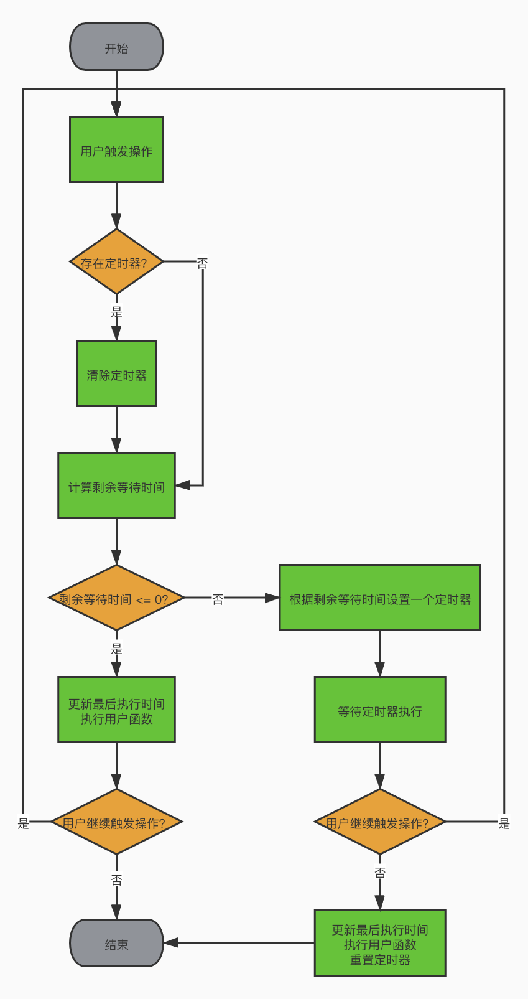
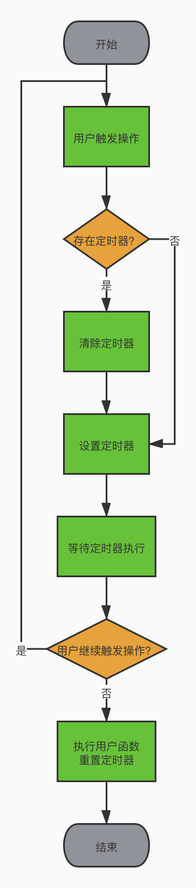

# 实现节流防抖函数


## 节流


### 1. 基本概念


`throttle(func, wait)`


每 wait 毫秒内最多只调用一次 func。


### 2. 应用场景

- 搜索框输入时的实时联想。
- 监听 scroll 事件计算位置信息。


### 3. 流程图





### 4. 编写代码


```js
function throttle(func, wait) {
  let lastTime = 0;
  let timer = null;

  return function () {
    if (timer) {
      clearTimeout(timer);
      timer = null;
    }

    let self = this;
    let args = arguments;
    let nowTime = +new Date();

    const remainWaitTime = wait - (nowTime - lastTime);

    if (remainWaitTime <= 0) {
      lastTime = nowTime;
      func.apply(self, args);
    } else {
      timer = setTimeout(function () {
        lastTime = +new Date();
        func.apply(self, args);
        timer = null;
      }, remainWaitTime);
    }
  };
}
```


## 防抖


### 1. 基本概念


`debounce(func, wait)`


自最近一次触发后延迟 wait 毫秒调用 func。


### 2. 应用场景

- 注册时输入完用户名后检测是否被占用。
- 监听 resize 事件计算尺寸信息。


### 3. 流程图





### 4. 编写代码


```js
function debounce(func, wait) {
  let timer = null;

  return function () {
    if (timer) {
      clearTimeout(timer);
      timer = null;
    }

    let self = this;
    let args = arguments;

    timer = setTimeout(function () {
      func.apply(self, args);
      timer = null;
    }, wait);
  };
}
```
