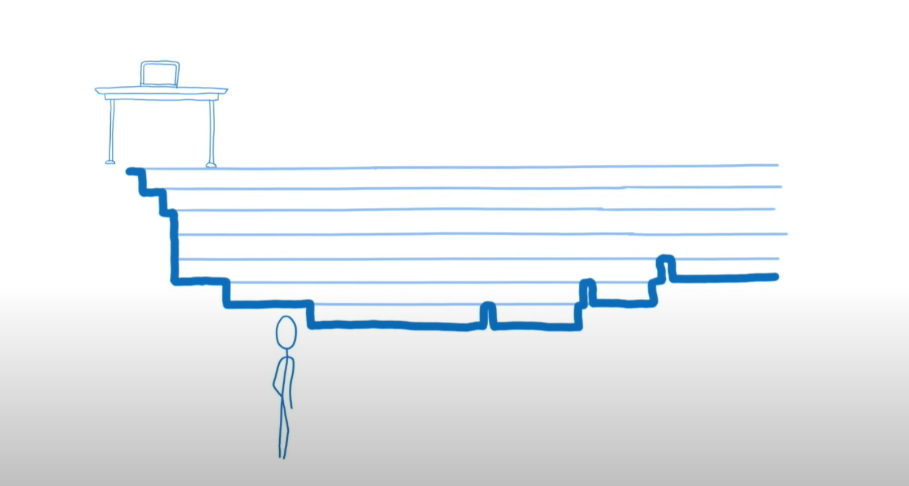
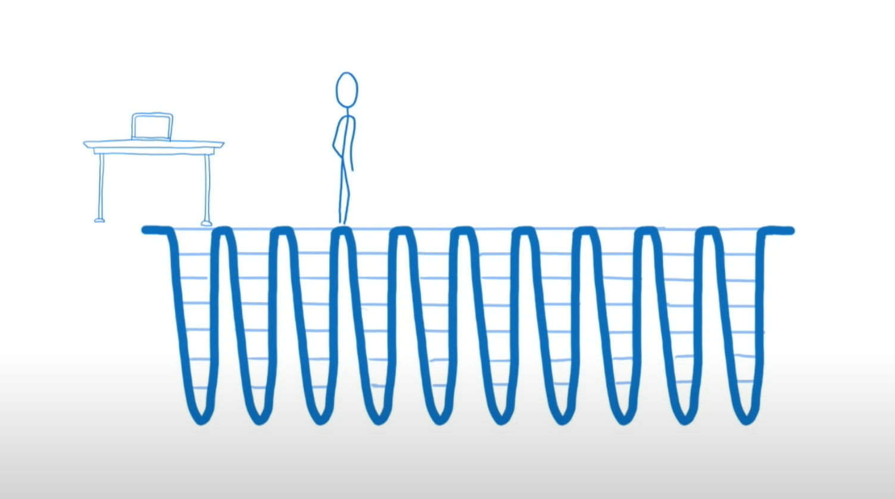
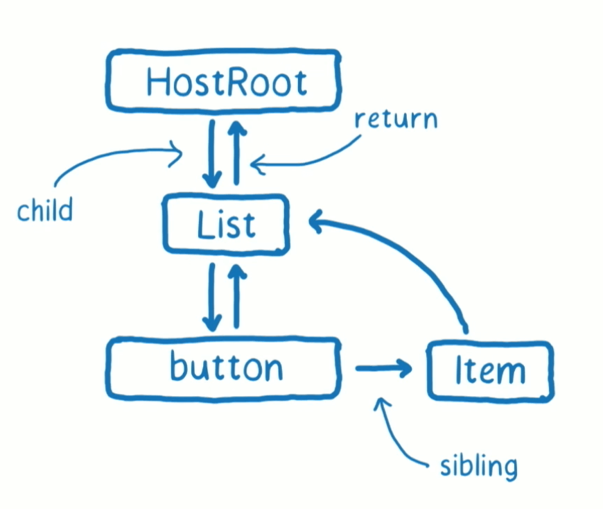
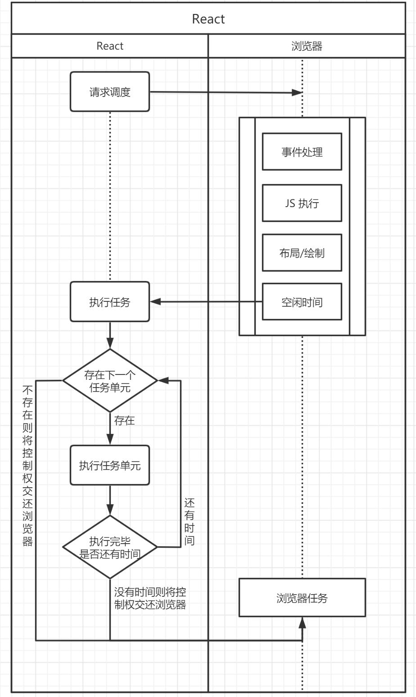

# React Fiber 的作用和原理


## 相关问题

- Fiber 是什么
- 谈谈你对 Fiber 的了解
- Fiber 对 React 的使用带来了什么影响


## 回答关键点


`调度` `深度优先遍历`


Fiber 是 React 16 中采用的新协调（reconciliation）引擎，主要目标是支持虚拟 DOM 的渐进式渲染。


Fiber 将原有的 Stack Reconciler 替换为 Fiber Reconciler，提高了复杂应用的可响应性和性能。主要通过以下方式达成目标：

- 对大型复杂任务的分片。
- 对任务划分优先级，优先调度高优先级的任务。
- 调度过程中，可以对任务进行挂起、恢复、终止等操作。


Fiber 对现有代码的影响：
由于 Fiber 采用了全新的调度方式，任务的更新过程可能会被打断，这意味着在组件更新过程中，render 及其之前的生命周期函数可能会调用多次。因此，在下列生命周期函数中不应出现副作用。

- shouldComponentUpdate
- React 16 中已经声明废弃的钩子
    - componentWillMount（UNSAFE_componentWillMount）
    - componentWillReceiveProps（UNSAFE_componentWillReceiveProps）
    - componentWillUpdate（UNSAFE_componentWillUpdate）


## 知识点深入


### 1. React 是如何工作的


```jsx
import React from "react";
import ReactDOM from "react-dom";

function App() {
  return <div>Hello, HZFE.</div>;
}

ReactDOM.render(<App />, document.getElementById("root"));
```


上面代码中我们引入的两个包，分别代表了 React 的 core API 层和渲染层，在这背后还有一层被称为协调器（Reconcilers）的层次。（协调器在[react-reconciler](https://github.com/facebook/react/tree/main/packages/react-reconciler)中实现）


一个 React 组件的渲染主要经历两个阶段：

- 调度阶段（Reconciler）：用新的数据生成一棵新的树，然后通过 Diff 算法，遍历旧的树，快速找出需要更新的元素，放到更新队列中去，得到新的更新队列。
- 渲染阶段（Renderer）：遍历更新队列，通过调用宿主环境的 API，实际更新渲染对应的元素。宿主环境如 DOM，Native 等。


对于调度阶段，新老架构中有不同的处理方式：


React 16 之前使用的是 Stack Reconciler（栈协调器），使用递归的方式创建虚拟 DOM，递归的过程是不能中断的。如果组件树的层级很深，递归更新组件的时间超过 16ms（以 60Hz 频率的显示器为例，浏览器绘制一帧的最小时间间隔为 1/60s 约等于 16ms），这时会发生俗称的掉帧现象，帧率不稳定时，用户就会感觉到卡顿。





> 图片来源 [react conf 17](https://www.youtube.com/watch?v=5Wd5rxT7e1U&list=PLb0IAmt7-GS3fZ46IGFirdqKTIxlws7e0&index=4)


React 16 及以后使用的是 Fiber Reconciler（纤维协调器），将递归中无法中断的更新重构为迭代中的异步可中断更新过程，这样就能够更好的控制组件的渲染。





> 图片来源 [react conf 17](https://www.youtube.com/watch?v=5Wd5rxT7e1U&list=PLb0IAmt7-GS3fZ46IGFirdqKTIxlws7e0&index=4)


### 2. Fiber Reconciler 如何工作


由于浏览器中 JS 的运行环境是单线程的，因此，一旦有任务耗时过长，就会阻塞其他任务的执行，导致浏览器不能及时响应用户的操作，从而使用户体验下降。为解决这个问题，React 推出了 Fiber Reconciler 架构。


在 Fiber 中，会把一个耗时很长的任务分成很多小的任务片，每一个任务片的运行时间很短。虽然总的任务执行时间依然很长，但是在每个任务小片执行完之后，都会给其他任务一个执行机会。
这样，唯一的线程就不会被独占，其他任务也能够得到执行机会。


为了实现渐进渲染的目的，Fiber 架构中引入了新的数据结构：Fiber Node，Fiber Node Tree 根据 React Element Tree 生成，并用来驱动真实 DOM 的渲染。


Fiber 节点的大致结构：


```js
{
    tag: TypeOfWork, // 标识 fiber 类型
    type: 'div', // 和 fiber 相关的组件类型
    return: Fiber | null, // 父节点
    child: Fiber | null, // 子节点
    sibling: Fiber | null, // 同级节点
    alternate: Fiber | null, // diff 的变化记录在这个节点上
    ...
}
```


Fiber 树结构如下：





> 图片来源 [react conf 17](https://www.youtube.com/watch?v=5Wd5rxT7e1U&list=PLb0IAmt7-GS3fZ46IGFirdqKTIxlws7e0&index=4)


Fiber 的主要工作流程：

1. `ReactDOM.render()` 引导 React 启动或调用 `setState()` 的时候开始创建或更新 Fiber 树。
2. 从根节点开始遍历 Fiber Node Tree， 并且构建 workInProgress Tree（reconciliation 阶段）。
    - 本阶段可以暂停、终止、和重启，会导致 react 相关生命周期重复执行。
    - React 会生成两棵树，一棵是代表当前状态的 current tree，一棵是待更新的 workInProgress tree。
    - 遍历 current tree，重用或更新 Fiber Node 到 workInProgress tree，workInProgress tree 完成后会替换 current tree。
    - 每更新一个节点，同时生成该节点对应的 Effect List。
    - 为每个节点创建更新任务。
3. 将创建的更新任务加入任务队列，等待调度。
    - 调度由 scheduler 模块完成，其核心职责是执行回调。
    - scheduler 模块实现了跨平台兼容的 requestIdleCallback。
    - 每处理完一个 Fiber Node 的更新，可以中断、挂起，或恢复。
4. 根据 Effect List 更新 DOM （commit 阶段）。
    - React 会遍历 Effect List 将所有变更一次性更新到 DOM 上。
    - 这一阶段的工作会导致用户可见的变化。因此该过程不可中断，必须一直执行直到更新完成。


React 调度流程图：





## 参考资料

1. [React Fiber Architecture](https://github.com/acdlite/react-fiber-architecture)
2. [React Conf 2017](https://www.youtube.com/watch?v=7HSd1sk07uU&list=PLb0IAmt7-GS3fZ46IGFirdqKTIxlws7e0)
3. [Inside Fiber](https://blog.ag-grid.com/inside-fiber-an-in-depth-overview-of-the-new-reconciliation-algorithm-in-react/)
