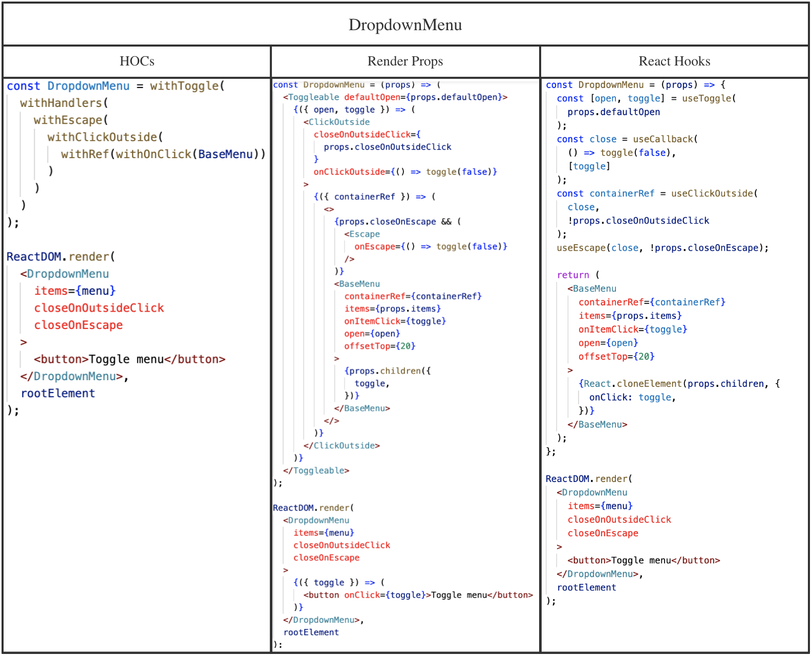

# HOC vs Render Props vs Hooks


## 相关问题

- 什么是 HOC / Render Props / Hooks
- 为什么需要 HOC / Render Props / Hooks
- 如何提高代码复用性
- Hooks 的实现原理
- Hooks 相比其他方案有什么优势


## 回答关键点


`复用性`


HOC / Render Props / Hooks 三种写法都可以**提高代码的复用性**，但实现方法不同：HOC 是对传入的组件进行增强后，返回新的组件给开发者；Render Props 是指将一个返回 React 组件的函数，作为 prop 传给另一个 React 组件的共享代码的技术；Hooks 是 React 提供的一组 API，使开发者可以在不编写 class 的情况下使用 state 和其他 React 特性。


## 知识点深入


### 1. HOC （Higher Order Component，即高阶组件）


HOC 是 React 中复用代码的编程模式。具体来说，高阶组件是一个纯函数，它接收一个组件并返回一个新的组件。常见例子：React Redux 的 connect，将 Redux Store 和 React 组件联系起来。


```js
// react-redux connect 例子
const ConnectedMyComponent = connect(mapState)(MyComponent);
```


```jsx
// 实现一个简单的 HOC 例子
function logProps(WrappedComponent) {
  return class extends React.Component {
    componentDidUpdate(prevProps) {
      console.log("Current props: ", this.props);
      console.log("Previous props: ", prevProps);
    }

    render() {
      return <WrappedComponent {...this.props} />;
    }
  };
}
```


### 2. Render Props


Render Props 是 React 中复用代码的编程模式。主要解决组件逻辑相同而渲染规则不同的复用问题。常见例子：React Router 中，自定义 render 函数，按需使用 routeProps 来渲染业务组件。


```js
ReactDOM.render(
  <Router>
    <Route
      path="/home"
      render={(routeProps) => (
        <div>Customize HZFE's {routeProps.location.pathname}</div>
      )}
    />
  </Router>,
  node
);
```


### 3. React Hooks


React Hooks 是 React 16.8 引入的一组 API。开发者可以在不使用 class 写法的情况下，借助 Hooks 在纯函数组件中使用状态和其他 React 功能。


```js
function Example() {
  const [count, setCount] = useState(0);

  return (
    <div>
      <p>You clicked {count} times</p>
      <button onClick={() => setCount(count + 1)}>Click me</button>
    </div>
  );
}
```


### 4. HOC vs Render Props vs Hooks


#### 痛点


在实际业务快速迭代过程中，组件常出现大量重复性工作，少量个性化定制的需求，如果不遵循 DRY（Don't Repeat Yourself）的规则，会造成项目臃肿和难以维护的问题。较早的方案是使用 HOC / Render Props 进行重构，然而这两种方案都会改变组件层级，容易形成“嵌套地狱”，使得代码的可读性下降。而 React Hooks 则很好地解决了这个问题。


#### 方案优劣


为辅助理解，可参考以下图片。图中所示为下拉列表功能的三种不同实现，相比于使用一个 Class 来书写下拉列表的所有功能，这三种方案都对组件进行了功能拆解，提高了代码的复用性。
（[代码来源](https://medium.com/simply/comparison-hocs-vs-render-props-vs-hooks-55f9ffcd5dc6)）




- **复用性**
  HOC、Render Props、Hooks 都有提高代码复用性的能力，但根据其设计模式上的差别，适用范围也会有所差异：HOC 基于单一功能原则，对传入组件进行增强；Render Props 复用数据源，按需渲染 UI；Hooks 对于不同场景的复用都有较好的普适性。
- **可读性 / 易用性**
  **HOC 可读性差，易用性差。**
  HOC 写法看似简洁，但开发者无法通过阅读 HOC 的调用辨别出方法的作用：看不到接收和返回的结构，增加调试和修复问题的成本；进行多个 HOC 组合使用时，不能确定使用顺序且有命名空间冲突风险，需要了解每个 HOC 的具体实现，难以维护。不建议过度使用 HOC，但比较适合不需要个性化开发定制时使用：常见于第三方库提供 HOC 类型的 API 给开发者进行功能增强。
  **Render Props 可读性较好，易用性强。**
  代码相对冗长，但能清晰看到组件接收的 props 以及传递的功能等，可以对 props 属性重命名，不会有命名冲突。但难以在 render 函数外使用数据源，且容易形成嵌套地狱。
  **Hooks 可读性强，易用性较好。**
  使用 Hooks 时，能清晰看到组件接收的 props 以及传递的功能等，可以对 props 属性重命名，不会有命名冲突，不存在嵌套地狱，且没有数据源获取及使用范围的限制。但 Hooks 编程应遵循函数式编程的实践，否则 Hooks 所需的依赖数组的处理会造成较大的心智负担。


## 参考资料

1. [Introducing Hooks](https://reactjs.org/docs/hooks-intro.html)
2. [Comparison: HOCs vs Render Props vs Hooks](https://medium.com/simply/comparison-hocs-vs-render-props-vs-hooks-55f9ffcd5dc6)
