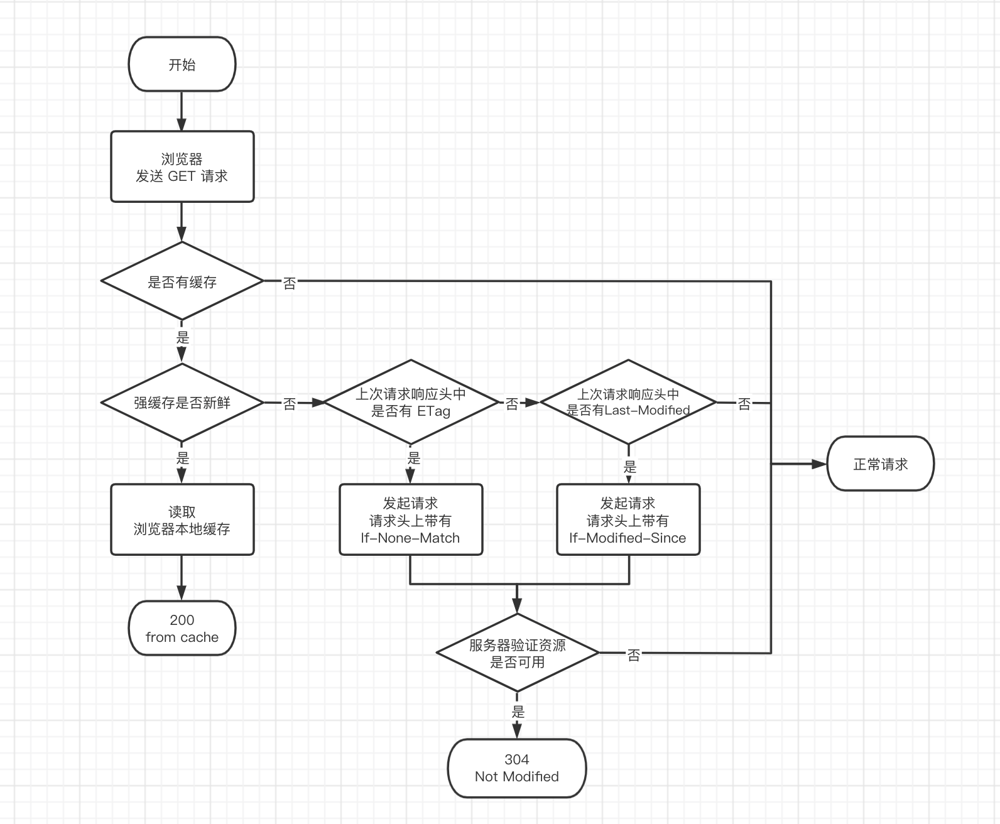

# HTTP 缓存机制

## 相关问题

- 了解浏览器的缓存机制吗
- 谈谈 HTTP 缓存
- 为什么要有缓存
- 缓存的优点是什么

## 回答关键点

`强缓存` `协商缓存`

HTTP 缓存主要分为**强缓存**和**协商缓存**。

**强缓存**可以通过 Expires / Cache-Control 控制，命中强缓存时不会发起网络请求，资源直接从本地获取，浏览器显示状态码 200 from cache。

**协商缓存**可以通过 Last-Modified / If-Modified-Since 和 Etag / If-None-Match 控制，开启协商缓存时向服务器发送的请求会带上缓存标识，若命中协商缓存服务器返回 304 Not Modified 表示浏览器可以使用本地缓存文件，否则返回 200 OK 正常返回数据。

## 知识点深入

### 1. 流程图

### 2.强缓存

#### 2.1 Expires

- HTTP/1.0 产物。
- 优先级低于 Cache-control: max-age。
- 缺点：使用本地时间判断是否过期，而本地时间是可修改的且并非一定准确的。

Expires 是由服务端返回的资源过期时间（GMT 日期格式/时间戳），若用户本地时间在过期时间前，则不发送请求直接从本地获取资源。

#### 2.2 Cache-Control

- HTTP/1.1 产物。
- 优先级高于 Expires。
- 正确区分 no-cache / no-store 的作用。

Cache-Control 是用于页面缓存的通用消息头字段，可以通过指定指令来实现缓存机制。

常用的字段有：

- **max-age** 设置缓存存储的最大时长，单位秒。
- **s-max-age** 与 max-age 用法一致，不过仅适用于代理服务器。
- **public** 表示响应可被任何对象缓存。
- **private** 表示响应只可被私有用户缓存，不能被代理服务器缓存。
- **no-cache** 强制客户端向服务器发起请求（禁用强缓存，可用协商缓存）。
- **no-store** 禁止一切缓存，包含协商缓存也不可用。
- **must-revalidate** 一旦资源过期，在成功向原始服务器验证之前，缓存不能用该资源响应后续请求。
- **immutable** 表示响应正文不会随时间改变（只要资源不过期就不发送请求）。

值得注意的是，虽然以上常用字段都是响应头的字段，但是 Cache-Control 同时也支持请求头，例如 `Cache-Control: max-stale=<seconds>` 表明客户端愿意接收一个已经过期但不能超出`<seconds>`秒的资源。

#### 2.3 拓展知识（冷门考点）

- HTTP/1.0 Pragma
    - 在 HTTP/1.0 时期用于禁用浏览器缓存 Pragma: no-cache。
- 缓存位置
    - 从 Service Worker 中读取缓存（只支持 HTTPS）。
    - 从内存读取缓存时 network 显示 memory cache。
    - 从硬盘读取缓存时 network 显示 disk cache。
    - Push Cache（推送缓存）（HTTP/2.0）。
    - 优先级 Service Worker > memory cache > disk cache > Push Cache。
- 最佳实践：资源尽可能命中强缓存，且在资源文件更新时保证用户使用到最新的资源文件
    - 强缓存只会命中相同命名的资源文件。
    - 在资源文件上加 hash 标识（webpack 可在打包时在文件名上带上）。
    - 通过更新资源文件名来强制更新命中强缓存的资源。

### 3. 协商缓存

#### 3.1 ETag / If-None-Match

- 通过唯一标识来验证缓存。
- 优先级高于 Last-Modified / If-Modified-Since。

如果资源请求的响应头里含有 ETag，客户端可以在后续的请求的头中带上 If-None-Match 头来验证缓存。若服务器判断资源标识一致，则返回 304 状态码告知浏览器可从本地读取缓存。

唯一标识内容是由服务端生成算法决定的，可以是资源内容生成的哈希值，也可以是最后修改时间戳的哈希值。所以 Etag 标识改变并不代表资源文件改变，反之亦然。

#### 3.2 Last-Modified / If-Modified-Since

- 通过资源的最后修改时间来验证缓存。
- 优先级低于 ETag / If-None-Match。
- 缺点：只能精确到秒，若 1s 内多次修改资源 Last-Modified 不会变化。

如果资源请求的响应头里含有 Last-Modified，客户端可以在后续的请求的头中带上 If-Modified-Since 头来验证缓存。若服务器判断资源最后修改时间一致，则返回 304 状态码告知浏览器可从本地读取缓存。

#### 3.3 拓展知识（冷门考点）

- ETag 在标识前面加 `W/` 前缀表示用弱比较算法（If-None-Match 本身就只用弱比较算法）。
- ETag 还可以配合 If-Match 检测当前请求是否为最新版本，若资源不匹配返回状态码 412 错误（If-Match 不加 `W/` 时使用强比较算法）。

### 4. 缓存的优缺点

**优点**

- 节省了不必要的数据传输，节省带宽。
- 减少服务端的负担，提高网站性能。
- 降低网络延迟，加快页面响应速度，增强用户体验。

**缺点**

- 不恰当的缓存设置可能会导致资源更新不及时，导致用户获取信息滞后。

## 参考资料

1. [HTTP Caching](https://developer.mozilla.org/en-US/docs/Web/HTTP/Caching)
