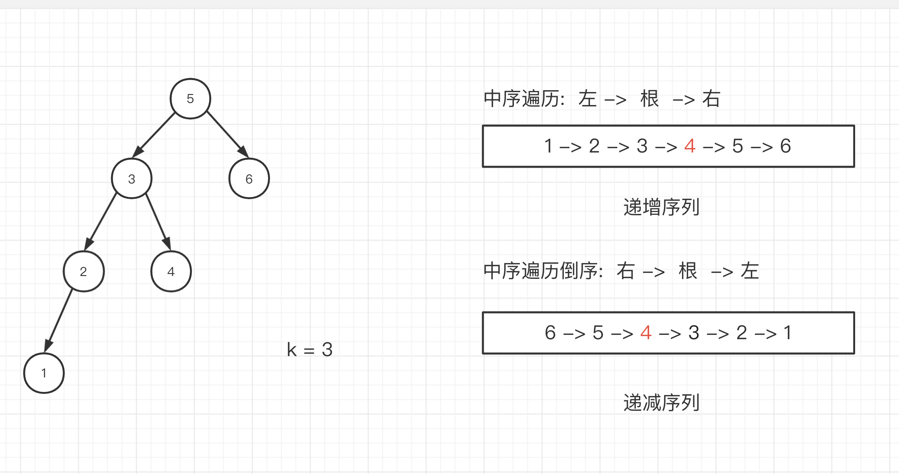
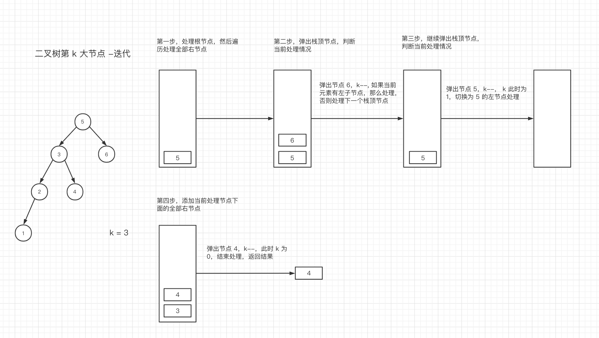

# 二叉搜索树的第 k 大的节点


## 题目描述


给定一棵二叉搜索树，请找出其中第 k 大的节点。


示例 1：


```text
输入: root = [3,1,4,null,2], k = 1
   3
  / \
 1   4
  \
   2
输出: 4
```


示例 2：


```text
输入: root = [5,3,6,2,4,null,null,1], k = 3
       5
      / \
     3   6
    / \
   2   4
  /
 1
输出: 4
```


## 解题基本知识


二叉搜索树（Binary Search Tree）又名二叉查找树、二叉排序树。它是一棵空树，或者是具有下列性质的二叉树： 若它的左子树不空，则左子树上所有结点的值均小于它的根结点的值； 若它的右子树不空，则右子树上所有结点的值均大于它的根结点的值； 它的左、右子树也分别为二叉排序树。


## 解法一： 递归


[在线链接](https://codesandbox.io/s/erchasousuoshudedi-k-dadejiedian-vfpbh?file=/index.html)


利用二叉搜索树的特性进行中序遍历。先遍历左节点，然后根节点，最后遍历右节点，得到的是一个递增序列，那么序列的倒序为递减序列。因此这道题我们可以转变为求二叉搜索树中序遍历倒序的第 k 个数。





```js
/**
 * Definition for a binary tree node.
 * function TreeNode(val) {
 *     this.val = val;
 *     this.left = this.right = null;
 * }
 */
/**
 * @param {TreeNode} root
 * @param {number} k
 * @return {number}
 */
const kthLargest = (root, k) => {
  let res = null; // 初始化返回值
  // 因为需要倒序第 k 个，所以处理是右节点，根节点，然后左节点
  const dfs = (root) => {
    if (!root) return; // 如果当前节点为 null，本轮处理结束
    dfs(root.right); // 开始处理右节点
    if (k === 0) return; // k 值 为 0，代表已经处理的节点超过目标节点，本轮处理结束
    if (--k === 0) {
      // 当 k 值 减 1 为 0，表示已经到了我们想要的 k 大 节点，保存当前值
      res = root.val;
    }
    dfs(root.left); // 处理左节点
  };
  dfs(root); // 从初始化节点开始处理
  return res;
};
```


### 复杂度分析：

- 时间复杂度 O(N)：无论 k 的值大小，递归深度都为 N，占用 O(N) 时间。
- 空间复杂度 O(N)：无论 k 的值大小，递归深度都为 N，占用 O(N) 空间。


## 解法二： 迭代


[在线链接](https://codesandbox.io/s/hzfe-suan-fa-er-cha-sou-suo-shu-de-di-k-da-de-jie-dian-die-dai-kq565?file=/index.html)


思路还是二叉树的中序遍历，利用栈的方式进行遍历。





```js
/**
 * Definition for a binary tree node.
 * function TreeNode(val) {
 *     this.val = val;
 *     this.left = this.right = null;
 * }
 */
/**
 * @param {TreeNode} root
 * @param {number} k
 * @return {number}
 */
var kthLargest = function (root, k) {
  if (!root) return 0;
  // 声明储存栈
  const stack = [];
  // 判断当前栈否有节点和当前遍历节点位置
  while (stack.length || root) {
    while (root) {
      // 往栈里添加当前节点，同时切换为右节点处理
      stack.push(root);
      root = root.right;
    }
    // 取出当前栈顶元素，根据添加的顺序，当前元素是栈内最大的
    const cur = stack.pop();
    k--;
    if (k === 0) return cur.val;
    // 切换为左节点处理
    root = cur.left;
  }
  return 0;
};
```

- 时间复杂度 O(N)：需要遍历整棵树一次，复杂度为 O(N)
- 空间复杂度 O(N)：需要额外空间栈进行储存树，复杂度为 O(N)


### 参考资料

1. [剑指 offer](https://book.douban.com/subject/6966465/)
