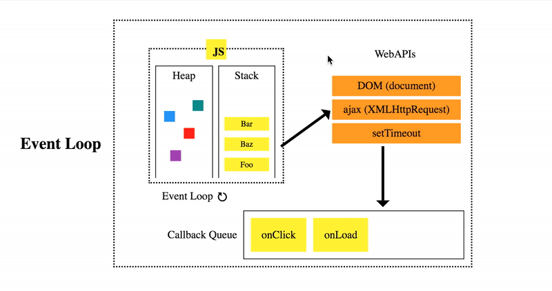
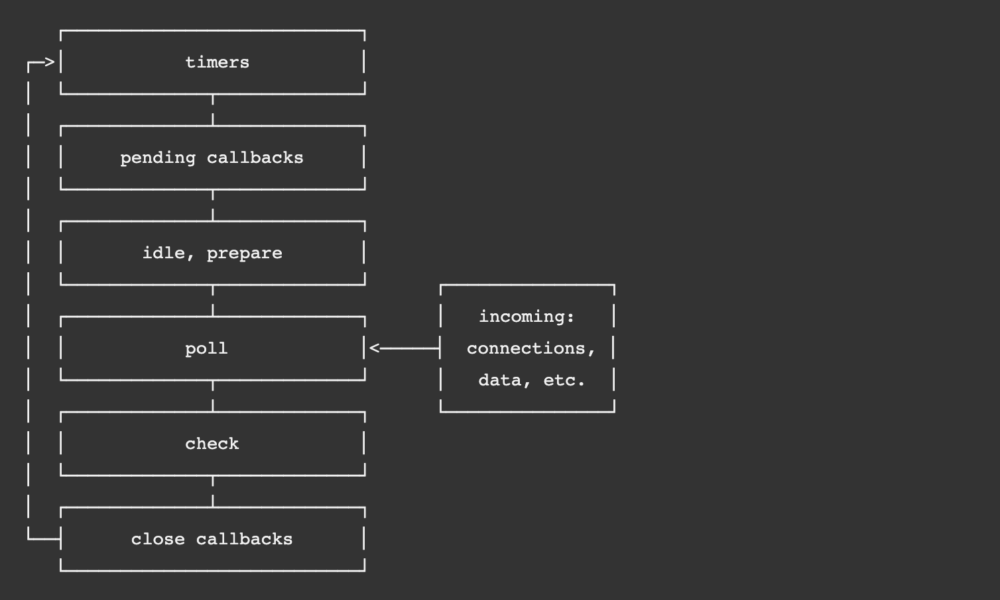

# 浏览器事件循环


## 相关问题

- 什么是浏览器事件循环
- 浏览器为什么需要事件循环
- Node.js 中的事件循环


## 回答关键点


`任务队列` `异步` `非阻塞`


浏览器需要事件循环来协调事件、用户操作、脚本执行、渲染、网络请求等。通过事件循环，浏览器可以利用**任务队列**来管理任务，让异步事件**非阻塞**地执行。每个客户端对应的事件循环是相对独立的。


## 知识点深入


### 1. 什么是浏览器事件循环


> 在计算机中，Event Loop 是一个程序结构，用于等待和发送消息和事件。 —— 维基百科


Event Loop 可以理解为一个消息分发器，通过接收和分发不同类型的消息，让执行程序的事件调度更加合理。


**浏览器事件循环是以浏览器为宿主环境实现的事件调度**，操作顺序如下：

1. 执行同步代码。
2. 执行一个任务（执行栈中没有就从任务队列中获取）。
3. 执行过程中如果遇到微任务，就将它添加到微任务的任务队列中。
4. 任务执行完毕后，立即执行当前微任务队列中的所有微任务（依次执行）。
5. 当前任务执行完毕，开始检查渲染，然后渲染线程接管进行渲染。
6. 渲染完毕后，JavaScript 线程继续接管，开始下一个循环。


下图展示了这个过程：





> 图片来源 [JS CONF EU 2014](https://www.youtube.com/watch?v=8aGhZQkoFbQ&t=31s)


### 2. 浏览器为什么需要事件循环


由于 JavaScript 是单线程的，且 JavaScript 主线程和渲染线程互斥，如果异步操作（如上图提到的 WebAPIs）阻塞 JavaScript 的执行，会造成浏览器假死。而事件循环为浏览器引入了任务队列（task queue），使得异步任务可以非阻塞地进行。


一个事件循环有一个或多个任务队列。任务队列是任务的集合，而不是队列。因为事件处理模型会选取**第一个可执行任务**开始执行，而不是队首的任务。


浏览器事件循环在处理异步任务时不会一直等待其返回结果，而是将这个事件挂起，继续执行栈中的其他任务。当异步事件返回结果，将它放到任务队列中，被放入任务队列不会立刻执行回调，而是等待当前执行栈中所有任务都执行完毕，主线程处于空闲状态，主线程会去查找任务队列中是否有任务，如果有，取出排在第一位的事件，并把这个事件对应的回调放到执行栈中，执行其中的同步代码。


### 3. 任务与微任务


异步任务被分为两类：任务（任务队列中的任务，非微任务）与微任务（microtask），两者的执行优先级也有所区别。


任务主要包含：script（整体代码）、setTimeout、setInterval、setImmediate、I/O、UI 交互事件。


微任务主要包含：Promise、MutationObserver 等。微任务队列不属于任务队列。


在当前执行栈为空的时候，主线程会查看微任务队列是否有事件存在。如果不存在，那么再去任务队列中取出一个事件并把对应的回调加入当前执行栈；如果存在，则会依次执行队列中事件对应的回调，直到微任务队列为空，然后去任务队列中取出最前面的一个事件，把对应的回调加入当前执行栈。如此反复，进入循环。下面通过一个具体的例子来进行分析：


```js
Promise.resolve().then(() => {
  // 微任务1
  console.log("Promise1");
  setTimeout(() => {
    // 任务2
    console.log("setTimeout2");
  }, 0);
});
setTimeout(() => {
  // 任务1
  console.log("setTimeout1");
  Promise.resolve().then(() => {
    // 微任务2
    console.log("Promise2");
  });
}, 0);
```


最后输出顺序为：`Promise1 => setTimeout1 => Promise2 => setTimeout2`。具体流程如下：

1. 同步任务执行完毕。微任务 1 进入微任务队列，任务 1 进入任务队列。
2. 查看微任务队列，微任务 1 执行，打印 Promise1，生成任务 2，进入任务队列。
3. 查看任务队列，任务 1 执行，打印 setTimeout1，生成微任务 2，进入微任务队列。
4. 查看微任务队列，微任务 2 执行，打印 Promise2。
5. 查看任务队列，任务 2 执行，打印 setTimeout2。


### 4. Node.js 中的事件循环


在 Node.js 中，事件循环表现出的状态与浏览器中大致相同。不同的是 Node.js 中有一套自己的模型。 Node.js 中事件循环的实现是依靠的 libuv 引擎。下图简要介绍了事件循环操作顺序：





> 图片来源 [Node.js 官网](https://nodejs.org/en/docs/guides/event-loop-timers-and-nexttick/#what-is-the-event-loop)

1. timers：本阶段执行已经被 setTimeout() 和 setInterval() 的调度回调函数。
2. pending callbacks：执行延迟到下一个循环迭代的 I/O 回调。
3. idle、prepare：仅系统内部使用。
4. poll：检索新的 I/O 事件;执行与 I/O 相关的回调（几乎所有情况下，除了关闭的回调函数，那些由计时器和 setImmediate() 调度的之外），其余情况 node 将在适当的时候在此阻塞。
5. check：setImmediate() 回调函数在这里执行。
6. close callbacks：一些关闭的回调函数，如：socket.on('close', ...)。


在每次运行的事件循环之间，Node.js 检查它是否在等待任何异步 I/O 或计时器，如果没有的话，则完全关闭。


需要注意的是，**任务与微任务的执行顺序在 Node.js 的不同版本中表现也有所不同**。同样通过一个具体的例子来分析：


```js
setTimeout(() => {
  console.log("timer1");
  Promise.resolve().then(function () {
    console.log("promise1");
  });
}, 0);

setTimeout(() => {
  console.log("timer2");
  Promise.resolve().then(function () {
    console.log("promise2");
  });
}, 0);
```

1. 在 Node.js v11 及以上版本中一旦执行一个阶段里的一个任务（setTimeout，setInterval 和 setImmediate），会立刻执行微任务队列，所以输出顺序为`timer1 => promise1 => timer2 => promise2`。
2. 在 Node.js v10 及以下版本，要看第一个定时器执行完成时，第二个定时器是否在完成队列中。
    - 如果第二个定时器还未在完成队列中，输出顺序为`timer1 => promise1 => timer2 => promise2`。
    - 如果是第二个定时器已经在完成队列中，输出顺序为`timer1 => timer2 => promise1 => promise2`。


## 参考资料

1. [whatwg event loops](https://html.spec.whatwg.org/multipage/webappapis.html#event-loops)
2. [wikipedia event loops](https://en.wikipedia.org/wiki/Event_loop)
3. [Node.js event loops](https://nodejs.org/en/docs/guides/event-loop-timers-and-nexttick/#what-is-the-event-loop)
