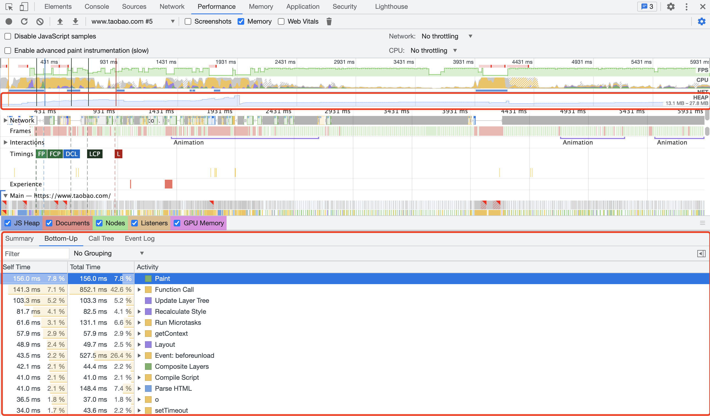
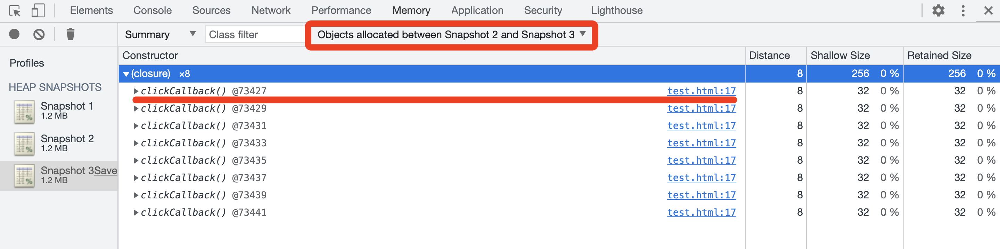
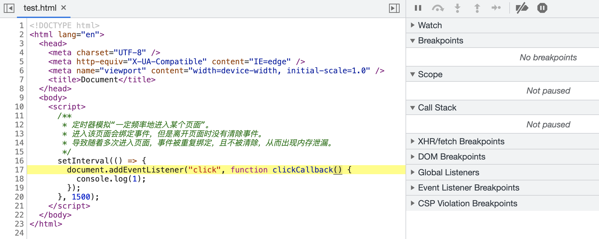
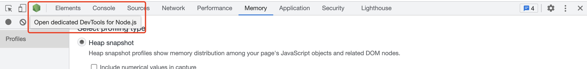

# 如何定位内存泄露


## 相关问题

- 垃圾回收机制


## 回答关键点


`垃圾回收` `DevTools`


内存泄漏是指不再使用的内存，没有被垃圾回收机制回收。当内存泄漏很大或足够频繁时，用户会有所感知：轻则影响应用性能，表现为迟缓卡顿；重则导致应用崩溃，表现为无法正常使用。为了避免内存泄漏带来的不良影响，需要对垃圾回收机制进行了解，掌握内存泄漏分析方法，完善线上相关监控措施。


内存泄漏定位和分析一般需要辅助工具，比如 Chrome DevTools。开发者可以通过 DevTools 记录页面活动概况，生成可视化分析结果，从时间轴中直观了解内存泄漏情况；利用 DevTools 获取若干次内存快照，检查内存堆栈变化；以及使用 Chrome 任务管理器，实时监控内存的使用情况。


## 知识点深入


### 1. 排查内存泄漏常见问题


在 JavaScript 中，当一些不再需要的数据仍然可达时，V8 会认为这些数据仍在被使用，不会释放内存。为了调试内存泄漏，我们需要找到被错误保留的数据，并确保 V8 能够将其清理掉。


代码量较小时，开发者通常可以基于以下基本原则进行快速自查：

1. 是否滥用全局变量，没有手动回收。
2. 是否没有正确销毁定时器、闭包。
3. 是否没有正确监听事件和销毁事件。


除此之外，开发者可以借助外部工具进行内存泄漏排查。


### 2. 使用 Chrome DevTools 定位内存泄漏


#### Performance





打开准备分析的页面和 DevTools 的 Performance 面板，勾选 Memory 并开始录制，在模拟用户操作一段时间后结束录制，DevTools 会将这段时间内的页面行为活动进行记录和分析。


通过生成的结果可以直观查看到内存时间线，了解内存随时间的占用变化，如果内存占用曲线成阶梯状一直上升，则可能存在内存泄漏。按需选取时间线中的区域片段，检查对应时间段内的活动类型和时间占用，作为排查和定位内存泄漏的辅助办法。


#### Memory





打开准备分析的页面和 DevTools 的 Memory 面板，按需生成快照。每个快照的内容是快照时刻，进行一次垃圾回收后，应用中所有可达的对象。


当开发者明确知道与内存泄漏关联的用户交互步骤时，可以生成多次内存快照进行对比，排查出泄漏的对象：在做用户交互操作之前，进行一次正常内存堆栈信息的快照；在做用户交互操作中或操作结束时，进行内存快照。使用 Comparison 视图或使用 filter 按需查看快照之间的差异。


上面的图中使用 filter 检查快照 2 和快照 3 的差异，通过结果可知在两个快照之间持续被分配 clickCallback 闭包。通过点击文件路径可以定位到内存泄漏的代码。





### 3. Node.js 中的内存泄漏定位


如果需要定位 Node.js 中的内存泄漏，启动 Node.js 时带上 --inspect 参数，以便利用 Chrome DevTools 工具生成 Memory 快照数据。如图所示，启动 Node.js 服务后，打开 Chrome DevTools，会有 Node 标识，点击可以打开 Node 专用 DevTools。





除此之外，也可以借助第三方包 heapdump 生成快照文件，导入至 Chrome DevTools 中的 Memory 进行快照对比。


启动 Node.js 时带上 --expose-gc 参数以便调用 `global.gc()` 方法触发垃圾回收。借助 `process.memoryUsage().heapUsed` 检查内存大小，作为内存泄漏的辅助判断。


```js
const heapdump = require("heapdump");

const capture = function () {
  global.gc();
  heapdump.writeSnapshot("./HZFE_HEAPSNAPSHOT/" + Date.now() + ".heapsnapshot");
  console.log("heapUsed:", process.memoryUsage().heapUsed);
};

capture();

/* 可能有内存泄漏的代码片段 start */
// code
/* 可能有内存泄漏的代码片段 end */

capture();
```


## 参考资料

1. [Chrome DevTools](https://developer.chrome.com/docs/devtools/)
2. [Fix memory problems](https://developer.chrome.com/docs/devtools/memory-problems/)
