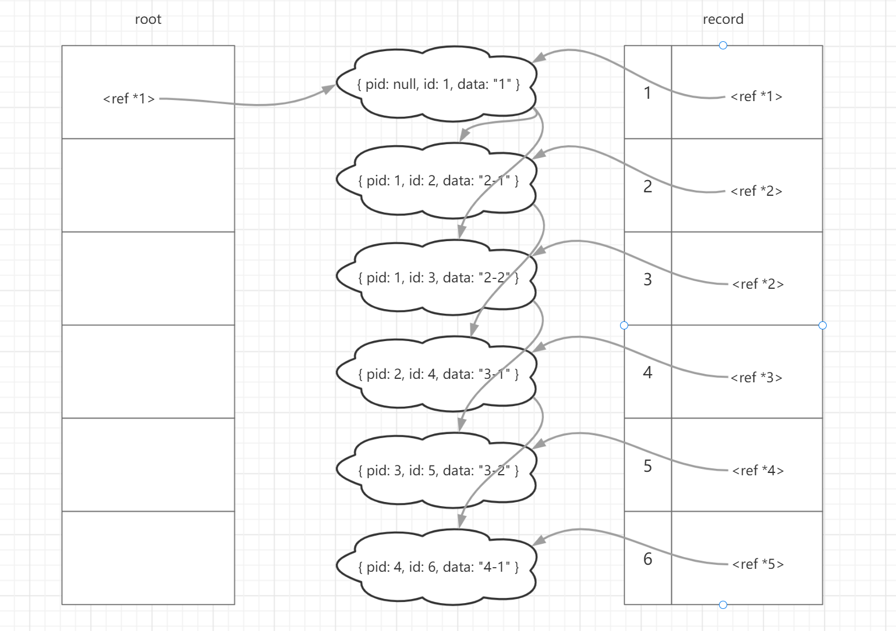

# 将列表还原为树状结构


需求来源分析：


在需要存储树结构的情况下，一般由于使用的关系型数据库（如 MySQL），是以类似表格的扁平化方式存储数据。因此不会直接将树结构存储在数据库中，通常是通过邻接表、路径枚举、嵌套集或闭包表来存储。


其中，邻接表是最常用的方案之一，其存储模型如下：


| id | pid | data |
| --- | --- | --- |
| 1 | 0 | a |
| 2 | 1 | b |
| 3 | 1 | c |


该模型代表了如下的树状结构：


```js
{
  id: 1,
  pid: 0,
  data: 'a',
  children: [
    {id: 2, pid: 1, data: 'b'},
    {id: 3, pid: 1, data: 'c'},
  ]
}
```


大部分情况下，会交给应用程序来构造树结构。


## 典型题目


```js
const list = [
  { pid: null, id: 1, data: "1" },
  { pid: 1, id: 2, data: "2-1" },
  { pid: 1, id: 3, data: "2-2" },
  { pid: 2, id: 4, data: "3-1" },
  { pid: 3, id: 5, data: "3-2" },
  { pid: 4, id: 6, data: "4-1" },
];
```


## 解法


### 解法一


递归解法：该方法简单易懂，从根节点出发，每一轮迭代找到 pid 为当前节点 id 的节点，作为当前节点的 children，递归进行。


```js
function listToTree(
  list,
  pid = null,
  { idName = "id", pidName = "pid", childName = "children" } = {}
) {
  return list.reduce((root, item) => {
    // 遍历每一项，如果该项与当前 pid 匹配，则递归构建该项的子树
    if (item[pidName] === pid) {
      const children = listToTree(list, item[idName]);
      if (children.length) {
        item[childName] = children;
      }
      return [...root, item];
    }
    return root;
  }, []);
}
```


时间复杂度分析：最坏的情况下，这棵树退化为链表，且倒序排列。每一轮迭代需要在最后面才找到目标节点。假设有 n 个元素，那么总迭代次数为 `n+(n-1) + (n-2) + ... + 1`，时间复杂度为 O(n^2)。


### 解法二


迭代法：利用对象在 js 中是引用类型的原理。第一轮遍历将所有的项，将项的 id 与项自身在字典中建立映射，为后面的立即访问做好准备。
由于操作的每一项都是对象，结果集 root 中的每一项和字典中相同 id 对应的项实际上指向的是同一块数据。后续的遍历中，直接对字典进行操作，操作同时会反应到 root 中。


```js
function listToTree(
  list,
  rootId = null,
  { idName = "id", pidName = "pid", childName = "children" } = {}
) {
  const record = {}; // 用空间换时间，用于将所有项的 id 及自身记录到字典中
  const root = [];

  list.forEach((item) => {
    record[item[idName]] = item; // 记录 id 与项的映射
    item[childName] = [];
  });

  list.forEach((item) => {
    if (item[pidName] === rootId) {
      root.push(item);
    } else {
      // 由于持有的是引用，record 中相关元素的修改，会在反映在 root 中。
      record[item[pidName]][childName].push(item);
    }
  });

  return root;
}
```


record 字典 与 root 结果集的参考内存引用关系如图所示：





时间复杂度分析：经历了两轮迭代，假设有 n 个元素，那么总迭代次数为 `n + n`，时间复杂度为 O(n)。


### 解法二变体


#### 变体一


在解法二的基础上，将两轮迭代合并成一轮迭代。采用边迭代边构建的方式：


```js
function listToTree(
  list,
  rootId = null,
  { idName = "id", pidName = "pid", childName = "children" } = {}
) {
  const record = {}; // 用空间换时间，用于将所有项的 id 及自身记录到字典中
  const root = [];

  list.forEach((item) => {
    const id = item[idName];
    const parentId = item[pidName];

    // 如果该项不在 record 中，则放入 record。如果该项已存在 （可能由别的项构建 pid 加入），则合并该项和已存在的数据
    record[id] = !record[id] ? item : { ...item, ...record[id] };

    const treeItem = record[id];

    if (parentId === rootId) {
      // 如果是根元素，则加入结果集
      root.push(treeItem);
    } else {
      // 如果父元素不存在，则初始化父元素
      if (!record[parentId]) {
        record[parentId] = {};
      }
      // 如果父元素没有 children, 则初始化
      if (!record[parentId][childName]) {
        record[parentId][childName] = [];
      }

      record[parentId][childName].push(treeItem);
    }
  });

  return root;
}
```


时间复杂度分析：经历了一轮迭代，假设有 n 个元素，那么时间复杂度为 O(n)。


#### 变体二


record 字典仅记录 id 与 children 的映射关系，代码更精简：


```js
function listToTree(
  list,
  rootId = null,
  { idName = "id", pidName = "pid", childName = "children" } = {}
) {
  const record = {}; // 用空间换时间，仅用于记录 children
  const root = [];

  list.forEach((item) => {
    const newItem = Object.assign({}, item); // 如有需要，可以复制 item ，可以不影响 list 中原有的元素。
    const id = newItem[idName];
    const parentId = newItem[pidName];

    // 如果当前 id 的 children 已存在，则加入 children 字段中，否则，初始化 children
    // item 与 record[id] 引用同一份 children，后续迭代中更新 record[parendId] 就会反映到 item 中
    newItem[childName] = record[id] ? record[id] : (record[id] = []);

    if (parentId === rootId) {
      root.push(newItem);
    } else {
      if (!record[parentId]) {
        record[parentId] = [];
      }
      record[parentId].push(newItem);
    }
  });

  return root;
}
```


时间复杂度分析：经历了一轮迭代，假设有 n 个元素，那么时间复杂度为 O(n)。


### 代码演示及总结


[Code Sandbox - List to Tree](https://codesandbox.io/s/practical-sun-vo4yi?file=/src/App.js)

- 递归法：在数据量增大的时候，性能会急剧下降。好处是可以在构建树的过程中，给节点添加层级信息。
- 迭代法：速度快。但如果想要不影响源数据，需要在 record 中存储一份复制的数据，且无法在构建的过程中得知节点的层级信息，需要构建完后再次深度优先遍历获取。
- 迭代法变体一：按需创建 children，可以避免空的 children 列表。
