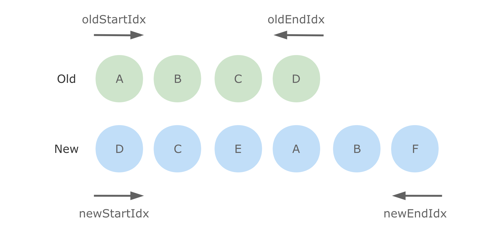

# 常见框架的 Diff 算法


## 相关问题

- 虚拟 DOM 是什么
- 虚拟 DOM 的作用
- 讲一下 Vue 的 Diff 算法


## 回答关键点


`虚拟 DOM` `时间复杂度O(n)`


现代网站大多具有复杂布局，大量的节点和交互操作等特征，直接操作 DOM 方法不当带来的性能问题不可忽视。虚拟 DOM 的本质是 JavaScript 对象，它可以代表 DOM 的一部分特征，是 DOM 的抽象简化版本。通过预先操作虚拟 DOM，在某个时机找出和真实 DOM 之间的差异部分并重新渲染，来提升操作真实 DOM 的性能和效率。


为达到这个目的，还需要关注两个问题：什么时候重新渲染，怎么高效选择重新渲染的范围。找出需要重新渲染的范围，就是 Diff 的过程。React 和 Vue 的 Diff 算法思路基本一致，只对同层节点进行比较，利用唯一标识符对节点进行区分。


## 知识点深入


### 1. Diff 算法


两棵树的比对和更新，涉及到树编辑距离（Tree Editing Distance）算法：将一棵树转化为另一棵树的最小操作成本。操作类型包括：删除、插入、修改。时间复杂度为 O(n^3)。


为了降低时间复杂度，React 和 Vue 的思路是基于以下两个假设条件，缩减递归迭代规模，将 Diff 算法的时间复杂度降低为 O(n)：

1. 相同类型的组件产生相同的 DOM 结构，反之亦然。所以不同类型组件的结构不需要进一步递归 Diff。
2. 同一层级的一组节点，可以通过唯一标识符进行区分。


### 2. React Reconciliation


在 React 中，将虚拟 DOM 和真实 DOM 进行比对然后同步的过程被称为 Reconciliation（调和），Fiber 是 React 16 中新的调和引擎。它的主要目标是实现虚拟 DOM 的增量渲染。


Diff 的大致过程是，当对比两棵虚拟 DOM 树时，React 先对比根元素。依据根元素的类型不同，会有不同的操作：

1. **不同类型的元素**
  如果元素的类型不同，React 会抛弃旧树并建立新树。如以下情况，会导致完全重建：
  ```html
  <!-- old -->
  <button class="bg-blue-100">HZFE</button>

  <!-- new -->
  <div class="bg-blue-100">HZFE</div>
  ```
2. **相同类型的元素**
  如果元素是两个相同类型的 React DOM 元素时，React 会查看两者的属性，保留 DOM 节点，只更新改变的属性。如以下情况，React 只更新颜色样式。
  ```html
  <!-- old -->
  <button class="bg-blue-100 text-center">HZFE</button>

  <!-- new -->
  <button class="bg-red-100 text-center">HZFE</button>
  ```


在元素类型相同的情况下，比对完元素后，会递归元素的子元素。默认情况下，React 会同时迭代新老两个子元素列表。对于列表的更新，React 建议在列表项中标识 key 属性。避免以下低效场景：


```html
<!-- bad -->
<!-- React 不会意识到可以保留<li>HZFE</li>和<li>Front-End</li>子树的完整，而是重写每个元素 -->

<!-- old -->
<ul>
  <li>HZFE</li>
  <li>Front-End</li>
</ul>
<!-- new -->
<ul>
  <li>Back-End</li>
  <li>HZFE</li>
  <li>Front-End</li>
</ul>

<!-- good -->
<!-- 子列表项有稳定且在兄弟节点中唯一的 key 属性， -->
<!-- React 使用 key 从新老树中匹配对应节点比较，提高 Diff 效率。 -->

<!-- old -->
<ul>
  <li key="2016">HZFE</li>
  <li key="2017">Front-End</li>
</ul>
<!-- new -->
<ul>
  <li key="2015">Back-End</li>
  <li key="2016">HZFE</li>
  <li key="2017">Front-End</li>
</ul>
```


### 2. Vue2.x Diff


Vue 的 Diff 算法和 React 的类似，只在同一层次进行比较，不进行跨层比较。如果两个元素被判定为不相同，则不继续递归比较。在 Diff 子元素的过程中，采用双端比较的方法，设立 4 个指针：

- oldStartIdx 指向旧子元素列表中，从左边开始 Diff 的元素索引。初始值：第一个元素的索引。
- newStartIdx 指向新子元素列表中，从左边开始 Diff 的元素索引。初始值：第一个元素的索引。
- oldEndIdx 指向旧子元素列表中，从右边开始 Diff 的元素索引。初始值：最后一个元素的索引。
- newEndIdx 指向新子元素列表中，从右边开始 Diff 的元素索引。初始值：最后一个元素的索引。





Vue 同时遍历新老子元素虚拟 DOM 列表，并采用头尾比较。一般有 4 种情况：

1. **当新老 start 指针指向的是相同节点**
  复用节点并按需更新。
  新老 start 指针向右移动一位。
2. **当新老 end 指针指向的是相同节点**
  复用节点并按需更新。
  新老 end 指针向左移动一位。
3. **当老 start 指针和新 end 指针指向的是相同节点**
  复用节点并按需更新，将节点对应的真实 DOM 移动到子元素列表队尾。
  老 start 指针向右移动一位。
  新 end 指针向左移动一位。
4. **当老 end 指针和新 start 指针指向的是相同节点**
  复用节点并按需更新，将节点对应的真实 DOM 移动到子元素列表队头。
  老 end 指针向左移动一位。
  新 start 指针向右移动一位。


在不满足以上情况的前提下，会尝试检查新 start 指针指向的节点是否有唯一标识符 key，如果有且能在旧列表中找到拥有相同 key 的相同类型节点，则可复用并按需更新，且移动节点到新的位置。新 start 指针向右移动一位。如果依旧不满足条件，则新增相关节点。


当新老列表的中任意一个列表的头指针索引大于尾指针索引时，循环遍历结束，按需删除或新增相关节点即可。


## 参考资料

- [Reconciliation](https://reactjs.org/docs/reconciliation.html)
- [patch](https://github.com/vuejs/vue/blob/2.6/src/core/vdom/patch.js)
