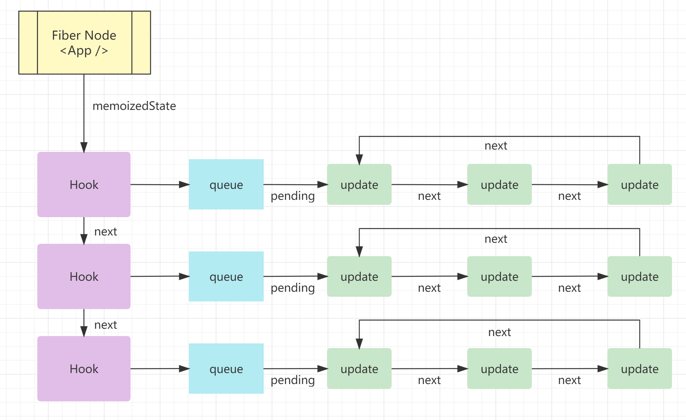
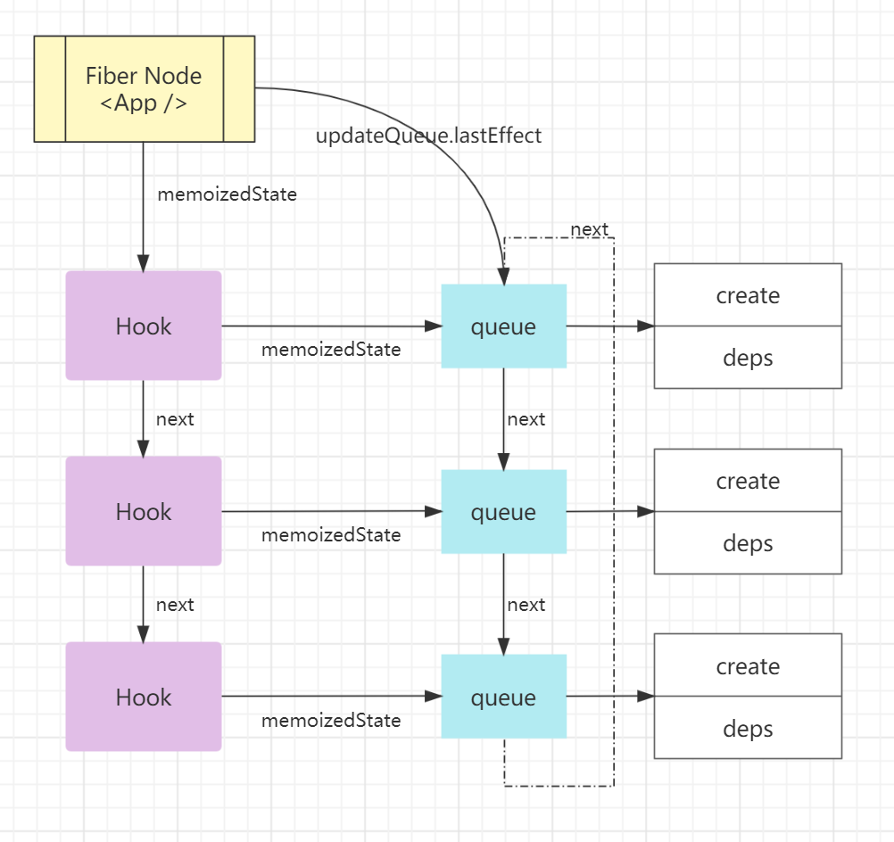

# React Hooks 实现原理


## 相关问题

- React Hooks 是什么
- React Hooks 是怎么实现的
- 使用 React Hooks 需要注意什么


## 回答关键点


`闭包` `Fiber` `链表`


Hooks 是 React 16.8 的新增特性。它可以让你在不编写 class 的情况下使用 state 以及其他的 React 特性。


Hooks 主要是利用闭包来保存状态，使用链表保存一系列 Hooks，将链表中的第一个 Hook 与 Fiber 关联。在 Fiber 树更新时，就能从 Hooks 中计算出最终输出的状态和执行相关的副作用。


使用 Hooks 的注意事项：

- 不要在循环，条件或嵌套函数中调用 Hooks。
- 只在 React 函数中调用 Hooks。


## 知识点深入


### 1. 简化实现


[React Hooks 模拟实现](https://codesandbox.io/s/hopeful-williams-id7ey?file=/src/index.js)


该示例是一个 React Hooks 接口的简化模拟实现，可以实际运行观察。其中 `react.js` 文件模拟实现了 `useState` 和 `useEffect` 接口，其基本原理和 react 实际实现类似。


### 2. 对比分析


#### 2.1 状态 Hook


模拟的 useState 实现中，通过闭包，将 state 保存在 `memoizedState[cursor]`。 memoizedState 是一个数组，可以按顺序保存 hook 多次调用产生的状态。


```js
let memoizedState = [];
let cursor = 0;
function useState(initialValue) {
  // 初次调用时，传入的初始值作为 state，后续使用闭包中保存的 state
  let state = memoizedState[cursor] ?? initialValue;
  // 对游标进行闭包缓存，使得 setState 调用时，操作正确的对应状态
  const _cursor = cursor;
  const setState = (newValue) => (memoizedState[_cursor] = newValue);
  // 游标自增，为接下来调用的 hook 使用时，引用 memoizedState 中的新位置
  cursor += 1;
  return [state, setState];
}
```


实际的 useState 实现经过多方面的[综合考虑](https://overreacted.io/why-do-hooks-rely-on-call-order/)，React 最终选择将 Hooks 设计为顺序结构，这也是 Hooks 不能条件调用的原因。


```js
function mountState<S>(
  initialState: (() => S) | S
): [S, Dispatch<BasicStateAction<S>>] {
  // 创建 Hook，并将当前 Hook 添加到 Hooks 链表中
  const hook = mountWorkInProgressHook();
  // 如果初始值是函数，则调用函数取得初始值
  if (typeof initialState === "function") {
    initialState = initialState();
  }
  hook.memoizedState = hook.baseState = initialState;
  // 创建一个链表来存放更新对象
  const queue = (hook.queue = {
    pending: null,
    dispatch: null,
    lastRenderedReducer: basicStateReducer,
    lastRenderedState: initialState,
  });
  // dispatch 用于修改状态，并将此次更新添加到更新对象链表中
  const dispatch: Dispatch<BasicStateAction<S>> = (queue.dispatch =
    (dispatchAction.bind(null, currentlyRenderingFiber, queue): any));
  return [hook.memoizedState, dispatch];
}
```


#### 2.1 副作用 Hook


模拟的 useEffect 实现，同样利用了 memoizedState 闭包来存储依赖数组。依赖数组进行浅比较，默认的比较算法是 `Object.is`。


```js
function useEffect(cb, depArray) {
  const oldDeps = memoizedState[cursor];
  let hasChange = true;
  if (oldDeps) {
    // 对比传入的依赖数组与闭包中保存的旧依赖数组，采用浅比较算法
    hasChange = depArray.some((dep, i) => !Object.is(dep, oldDeps[i]));
  }
  if (hasChange) cb();
  memoizedState[cursor] = depArray;
  cursor++;
}
```


实际的 useEffect 实现：


```js
function mountEffect(
  create: () => (() => void) | void,
  deps: Array<mixed> | void | null
): void {
  return mountEffectImpl(
    UpdateEffect | PassiveEffect, // fiberFlags
    HookPassive, // hookFlags
    create,
    deps
  );
}
function mountEffectImpl(fiberFlags, hookFlags, create, deps): void {
  // 创建hook
  const hook = mountWorkInProgressHook();
  const nextDeps = deps === undefined ? null : deps;
  // 设置 workInProgress 的副作用标记
  currentlyRenderingFiber.flags |= fiberFlags; // fiberFlags 被标记到 workInProgress
  // 创建 Effect, 挂载到 hook.memoizedState 上
  hook.memoizedState = pushEffect(
    HookHasEffect | hookFlags, // hookFlags 用于创建 effect
    create,
    undefined,
    nextDeps
  );
}
```


### 3. Hooks 如何与 Fiber 共同工作


在了解如何工作之前，先看看 Hook 与 Fiber 的部分结构定义：


```js
export type Hook = {
  memoizedState: any, // 最新的状态值
  baseState: any, // 初始状态值
  baseQueue: Update<any, any> | null,
  queue: UpdateQueue<any, any> | null, // 环形链表，存储的是该 hook 多次调用产生的更新对象
  next: Hook | null, // next 指针，之下链表中的下一个 Hook
};
```


```js
export type Fiber = {
  updateQueue: mixed, // 存储 Fiber 节点相关的副作用链表
  memoizedState: any, // 存储 Fiber 节点相关的状态值

  flags: Flags, // 标识当前 Fiber 节点是否有副作用
};
```


与上节中的模拟实现不同，真实的 Hooks 是一个单链表的结构，React 按 Hooks 的执行顺序依次将 Hook 节点添加到链表中。下面以 useState 和 useEffect 两个最常用的 hook 为例，来分析 Hooks 如何与 Fiber 共同工作。


在每个**状态 Hook**（如 useState）节点中，会通过 queue 属性上的循环链表记住所有的更新操作，并在 update 阶段依次执行循环链表中的所有更新操作，最终拿到最新的 state 返回。


状态 Hooks 组成的链表的具体结构如下图所示：





在每个**副作用 Hook**（如 useEffect）节点中，创建 effect 挂载到 Hook 的 memoizedState 中，并添加到环形链表的末尾，该链表会保存到 Fiber 节点的 updateQueue 中，在 commit 阶段执行。


副作用 Hooks 组成的链表的具体结构如下图所示：





## 参考资料

1. [Why Do React Hooks Rely on Call Order?](https://overreacted.io/why-do-hooks-rely-on-call-order/)
2. [React hooks: not magic, just arrays](https://medium.com/@ryardley/react-hooks-not-magic-just-arrays-cd4f1857236e)
