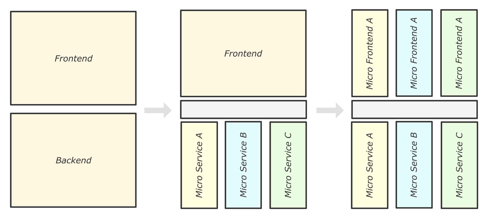

# 谈谈微前端

## 相关问题

- 为什么要用微前端
- 微前端的优缺点

## 回答关键点

`独立开发` `独立运行` `独立部署` `自治`

微前端是一种架构理念，它将较大的前端应用拆分为若干个可以独立交付的前端应用。这样的好处是每个应用大小及复杂度相对可控。在合理拆分应用的前提下，微前端能降低应用之间的耦合度，提升每个团队的自治能力。

目前市面有各类不同的微前端方案，但没有完美的解决方案。微前端方案通常需要考虑：应用加载机制、通信机制、代码隔离机制等问题。

## 知识点深入

### 微前端使用场景

前端工程化中，一个前端项目常以组件或模块的粒度进行代码拆分，然后通过 script 标签、npm 包、submodules 或者动态加载（Dynamic import）等形式将代码集成到项目中。而微前端则是以更大的粒度对代码进行上下文划分，将较庞大的应用拆分成多个技术栈独立的应用，再通过技术手段将若干应用集成在一个容器内。

如果项目中存在以下问题，可参考微前端架构进行优化：

- **存量系统如何渐进式地拥抱新技术**：存量系统的技术栈老旧，重构和开发成本高。在做新的功能开发时可以考虑采用与老项目不同的技术栈，通过微前端的方案将新的功能与老系统进行集成。同时微前端架构也给老旧系统的技术升级和平滑迁移提供保障。
- **大型系统的开发及沟通成本上升**：通过分析业务功能，将系统拆分成多个独立子系统，使每个子系统能独立开发、运行及部署。将工程复杂度拆分并限制在子系统单元内。避免随需求迭代，项目维护成本增大，跨部门沟通困难导致效率低下等问题。

### 微前端部分核心能力

1. **路由管理**
  一般我们使用 Hash 或者 History 模式来对路由进行监听，如 hashchange 或 popstate 事件。
  目前常见的微前端解决方案主要是路由驱动的。在微前端的基座，进行子应用的路由注册，如 `{ path: '/microA/*' }` ，基座根据路由匹配情况，按需挂载子应用。具体路由跳转规则由子应用接管响应。
2. **隔离机制**
  支持样式隔离和 JS 沙箱机制，以保证应用之间的样式或全局变量、事件等互不干扰。在应用卸载时，应当对子应用中产生的事件、全局变量、样式表等进行卸载。
  对于新的项目，做好样式隔离的方式包括采用 CSS Module、CSS in JS 或规范使用命名空间等。对于已有项目的 CSS 隔离，可以在打包阶段利用工具（如 postcss）自动对样式添加前缀。
  实现 JS 沙箱机制可以借助 Proxy 和 with 的能力，分别做对 Window 对象的访问进行拦截和修改子应用作用域的操作。不支持 Proxy 的宿主环境，可以采用快照的思路：对进入子应用前的 Window 对象进行快照，用于后续卸载子应用时还原 Window 对象；在卸载子应用时对 Window 对象进行快照，用于后续再次加载子应用时还原 Window 对象。
3. **消息通信**
  合理划分应用，可以避免频繁的跨应用通信。同时应当避免子应用之间直接通信。
  常见的消息通信机制可以通过原生 CustomEvent 类实现，子应用通过 dispatchEvent 和 addEventListener 来对自定义事件进行下发和监听。除此之外，借助 props 通过主应用向子应用传参，达到通信目的也是常见方法。
4. **依赖管理**
  常见的微前端框架中，基座应用统一对子应用的状态进行管理。根据路由和子应用状态，按需触发生命周期函数，做请求加载、渲染、卸载等动作。而多个子应用间可能存在一些公共库的依赖。
  为减少这类资源的重复加载，通常可以借助 webpack5 的 Module Federation 在构建时进行公共依赖的配置，实现运行时依赖共享的能力。除了使用打包工具的能力，也可以从代码层面通过实现类 external 功能对公共依赖进行管理。

### 关联技术

#### Web Components

Web Components 允许开发者不借助框架，实现一些可重用的自定义组件。构建一个 Web Components 通常使用到 customElements、Shadow DOM 的 API，和 templates、slot 标签。

基于 Web Components 开发，可以天然契合微前端的一些特性：技术栈无关，应用间隔离。但兼容性较差，不支持 IE。

#### iframe

iframe 常用于将应用嵌入另一个宿主应用中。这其实已经是一种微前端的思维。只使用 iframe 方案引入子应用的好处是浏览器兼容性强，接入成本低，样式及脚本天然隔离。但是由于 iframe 和宿主应用完全隔离，各自独立运行，导致了诸多限制，如：

1. 资源无法共享；
2. iframe 中的 UI 无法跨越 iframe 窗口边界；
3. 刷新页面时 iframe 中的路由状态丢失；

目前腾讯提供了一个新的微前端实施思路：借助 ShadowRoot 渲染子应用的 DOM；iframe 负责运行子应用的 JavaScript 代码，从而实现 JS 沙箱和 CSS 隔离能力。另外，在保证子应用和主应用同源的前提下，将子应用的路由变化同步到主应用中，从而保证刷新页面后，路由地址正常。

#### webpack5 Module Federation

目前市面上的微前端方案中，有基于 Module Federation 的微前端框架实践。Module Federation 是 webpack 提供的一个插件，他支持通过配置以下核心参数，在打包构建阶段确定集成策略：

1. exposes 参数，指定应用可以描述当自己作为被加载的远程模块时，可暴露给其他应用使用的模块路径。
2. remotes 参数，指定应用可以从远端加载的远程模块地址。
3. shared 参数，指定应用可以与其他远程模块共享的依赖（精确到版本）。

## 参考资料

1. [micro-frontends](https://micro-frontends.org/)
2. [single-spa](https://github.com/single-spa/single-spa)
3. [qiankun](https://github.com/umijs/qiankun)
4. [garfish](https://github.com/modern-js-dev/garfish)
5. [micro-app](https://github.com/micro-zoe/micro-app)
