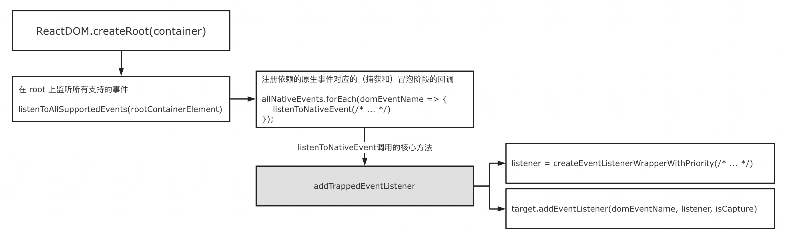
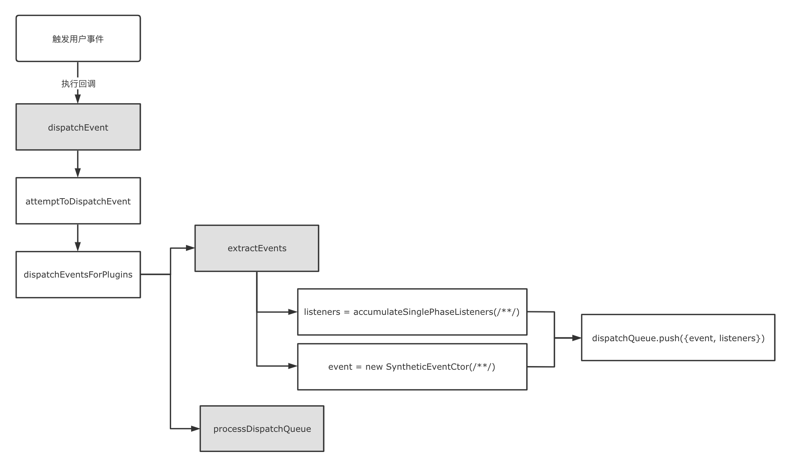

# React 事件机制原理


## 相关问题

- React 合成事件与原生 DOM 事件的区别
- React 如何注册和触发事件
- React 事件如何解决浏览器兼容问题


## 回答关键点


React 的事件处理机制可以分为两个阶段：初始化渲染时在 root 节点上注册原生事件；原生事件触发时模拟捕获、目标和冒泡阶段派发合成事件。通过这种机制，冒泡的原生事件类型最多在 root 节点上注册一次，节省内存开销。且 React 为不同类型的事件定义了不同的处理优先级，从而让用户代码及时响应高优先级的用户交互，提升用户体验。


React 的事件机制中依赖合成事件这个核心概念。合成事件在符合 W3C 规范定义的前提下，抹平浏览器之间的差异化表现。并且简化事件逻辑，对关联事件进行合成。如每当表单类型组件的值发生改变时，都会触发 onChange 事件，而 onChange 事件由 change、click、input、keydown、keyup 等原生事件组成。


## 知识点深入


### 1. 原生事件和合成事件


JavaScript 通过事件可以和 DOM 进行交互。


#### 1.1 原生事件


主流浏览器基于 DOM2、DOM3 规范，实现标准化 DOM 事件。基于 Event 实现了浏览器中常见的用户事件如 UIEvent、InputEvent、MouseEvent 等。


在事件发生时，相关信息会存储在 Event 的实例对象中，对象包含 currentTarget、detail、target、preventDefault()、stopPropagation() 等属性和方法。DOM 节点可以通过 addEventListener 和 removeEventListener 来添加或移除事件监听函数。


```ts
// Event 属性
boolean bubbles
boolean cancelable
DOMEventTarget currentTarget
boolean defaultPrevented
number eventPhase
boolean isTrusted
void preventDefault()
void stopPropagation()
void stopImmediatePropagation()
DOMEventTarget target
number timeStamp
string type
```


#### 1.2 React 合成事件


React 的事件机制中，在遵循规范的前提下，引入新的事件类型：合成事件（SyntheticEvent）。基于合成事件实现了浏览器中常见的用户事件，并对事件进行规范化处理，使它们在不同浏览器中具有一致的属性。


在事件发生时，相关信息会存储在 SyntheticEvent 的实例对象中，对象包含原生事件对象类似的属性。


```ts
// SyntheticEvent 属性
boolean bubbles
boolean cancelable
DOMEventTarget currentTarget
boolean defaultPrevented
number eventPhase
boolean isTrusted
DOMEvent nativeEvent
void preventDefault()
boolean isDefaultPrevented()
void stopPropagation()
boolean isPropagationStopped()
void persist()
DOMEventTarget target
number timeStamp
string type
```


但是合成事件与原生事件不是一一映射的关系。比如 onMouseEnter 合成事件映射原生 mouseout、mouseover 事件。React 通过 registrationNameDependencies 来记录合成事件和原生事件的映射关系：


```js
/**
 * Mapping from registration name to event name
 */
export const registrationNameDependencies = {
  onClick: ["click"],
  onMouseEnter: ["mouseout", "mouseover"],
  onChange: [
    "change",
    "click",
    "focusin",
    "focusout",
    "input",
    "keydown",
    "keyup",
    "selectionchange",
  ],
  // ...
};
```


### 2. React 事件机制


#### 2.1 React 事件的注册





使用 ReactDOM.createRoot 创建 Root 时，React 会调用 listenToAllSupportedEvents 方法对所有支持的原生事件进行监听：

1. allNativeEvents 用于收集所有合成事件相关联的原生事件名。这个收集动作在事件插件初始化阶段完成；


```js
SimpleEventPlugin.registerEvents();
EnterLeaveEventPlugin.registerEvents();
ChangeEventPlugin.registerEvents();
SelectEventPlugin.registerEvents();
BeforeInputEventPlugin.registerEvents();
```

1. 对每个原生事件调用 addTrappedEventListener 函数。该函数最终使用 addEventListener 方法，对原生事件进行捕获或冒泡阶段的事件监听注册。


```ts
function addTrappedEventListener(
  targetContainer: EventTarget,
  domEventName: DOMEventName,
  eventSystemFlags: EventSystemFlags,
  isCapturePhaseListener: boolean
) {
  let listener = createEventListenerWrapperWithPriority(
    targetContainer,
    domEventName,
    eventSystemFlags
  );

  // ...

  if (isCapturePhaseListener) {
    addEventCaptureListener(targetContainer, domEventName, listener);
  } else {
    addEventBubbleListener(targetContainer, domEventName, listener);
  }
}
```


基于以上流程可知，调用 ReactDOM.createRoot 方法时，就已经在 root 节点上初始化所有原生事件的监听回调函数。而不是在组件上写合成事件的监听时，才开始注册事件回调。


#### 2.2 React 事件的触发





在注册事件阶段调用的 addTrappedEventListener 方法中，会使用 createEventListenerWrapperWithPriority 函数来创建事件回调。createEventListenerWrapperWithPriority 函数根据事件类型，划分出若干个不同优先级的 dispathEvent。事件回调最终都调用进 dispatchEvent 方法。


因此触发一个原生事件时，大致的执行流程如下：

1. 原生事件触发后，进入 dispatchEvent 回调方法；
2. attemptToDispatchEvent 方法根据该原生事件查找到当前原生 Dom 节点和映射的 Fiber 节点；
3. 事件和 Fiber 等信息被派发给插件系统进行处理，插件系统调用各插件暴露的 extractEvents 方法；
4. accumulateSinglePhaseListeners 方法向上收集 Fiber 树上监听相关事件的其他回调函数，构造合成事件并加入到派发队列 dispatchQueue 中；
5. 调用 processDispatchQueue 方法，基于捕获或冒泡阶段的标识，按倒序或顺序执行 dispatchQueue 中的方法；


## 参考资料

1. [SyntheticEvent](https://reactjs.org/docs/events.html)
2. [Handling Events](https://reactjs.org/docs/handling-events.html)
3. [UI Events](https://www.w3.org/TR/DOM-Level-3-Events)
